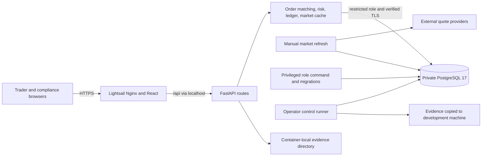

# Sentinel Markets architecture

This mock brokerage uses a React/Vite frontend, a FastAPI backend, and PostgreSQL 17. The public recruiter demo runs on AWS Lightsail in the selected Region `us-east-2`; its private database contains the verified copy of the local PostgreSQL data. The local Docker Compose database is a separate, clean development instance. The [threat model](docs/THREAT_MODEL.md) shows the trust boundaries, and the [AWS runbook](docs/aws_deployment.md) records the live resources and recovery path.

Traders submit limit or market orders through `/orders/`, or direct quote-based trades through `/trades/`. Idempotency keys prevent duplicate submissions. The order book reserves cash or shares, matches by price and time, and records fills through the [double-entry ledger](docs/ledger.md). The database login used by the API cannot update or delete ledger entries.

The [market-data refresh command](docs/market-data.md) writes provider prices to the database cache. Trading checks reference that cache for freshness and price bands. It was run once after AWS cutover; a hosted schedule is still open. A combined control runner checks database grants, role-change auditing, ledger integrity, market-data freshness, order price bands, and idempotency records. The AWS control run wrote evidence on a temporary operator host and copied it to ignored local `grc/evidence/`. The API container has a separate evidence directory, so its live compliance console currently shows `not_run` until evidence is shared or imported. Independent evidence storage remains open.

Role changes require an admin request, approval by a different compliance officer, and a privileged operator command. Database triggers audit direct role updates. The app login cannot update roles or role-change records. The AWS database has the same restricted grants and triggers; the latest hosted role and audit controls passed. See the [control matrix](grc/control_matrix.csv) and [current action items](docs/GRC_ACTION_ITEMS.md) for operating status and remaining gaps.
