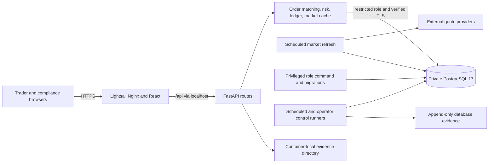

# Sentinel Markets architecture

This mock brokerage uses a React/Vite frontend, a FastAPI backend, and PostgreSQL 17. The public recruiter demo runs on AWS Lightsail in the selected Region `us-east-2`; its private database contains the verified copy of the local PostgreSQL data. The local Docker Compose database is a separate, clean development instance. The [threat model](docs/THREAT_MODEL.md) shows the trust boundaries, and the [AWS runbook](docs/aws_deployment.md) records the live resources and recovery path.

[View the stack diagram](docs/diagrams/sentinel-markets-stack.png) ([dark](docs/diagrams/sentinel-markets-stack-dark.png), [self-contained HTML](docs/diagrams/sentinel-markets-stack.html)).

Traders submit limit or market orders through `/orders/`, or direct quote-based trades through `/trades/`. Idempotency keys prevent duplicate submissions. The order book reserves cash or shares, matches by price and time, and records fills through the [double-entry ledger](docs/ledger.md). The database login used by the API cannot update or delete ledger entries.

The [market-data refresh command](docs/market-data.md) writes provider prices to the database cache. Trading checks reference that cache for freshness and price bands. The hosted service has `SCHEDULED_JOBS_ENABLED=true`: its API process refreshes quotes, reconciles the ledger, runs 23 controls, and scans activity for approved surveillance and AML versions. A database lease and persisted next-due time coordinate concurrent instances. Detector cursor locks serialize scans and preserve retry boundaries. Evidence is inserted into append-only `control_evidence`; the console reads those rows. Independent retention outside the database remains open. Data-quality, intent, signal, and brief checks are deployed, but full data-quality enforcement remains unfinished. The forecast is an advisory historical-volatility signal and does not change an order limit.

Surveillance rules live in versioned YAML under `grc/surveillance/`. The YAML file is not an activation. An admin or compliance officer requests a version, and a different admin or compliance officer approves it. The backtest scores labeled scenarios and does not open production cases. No rule is active on the hosted service, and the model-risk policy is still pending owner review.

Paper deposits and withdrawals, AML rules, a local sanctions fixture, and incident cases are deployed. Cash updates lock the user row and commit the balance, movement, ledger posting, and idempotency response together. Detection can retry after a committed movement. AML YAML is not an activation. `YENTE_URL` is empty, so screening uses a one-name fixture that is not a sanctions list. SAR text is a template that cites the case event ids. It is not an external model, and it does not decide to file. Auditors can download a hashed evidence zip. All AML and surveillance rules remain inactive pending independent approval.

Sign-in can require a six-digit authenticator code. The secret is encrypted with `JWT_SECRET`; rotation requires re-enrollment. `MFA_REQUIRED` is false, so broad enrollment is not enforced, although high-risk sign-ins can require it. An enrolled account completes a code before a session, and a large transaction needs a current code. Factor and challenge consumption use a consistent lock order to prevent replay. Passkey signing is not implemented. The access-control policy is still pending owner review.

Role changes require an admin request, approval by a different compliance officer, and a privileged operator command. Database triggers audit direct role updates. The app login cannot update roles or role-change records. The AWS database has the same restricted grants and triggers; the latest hosted role and audit controls passed. See the [control matrix](grc/control_matrix.csv) and [current action items](docs/GRC_ACTION_ITEMS.md) for operating status and remaining gaps.
