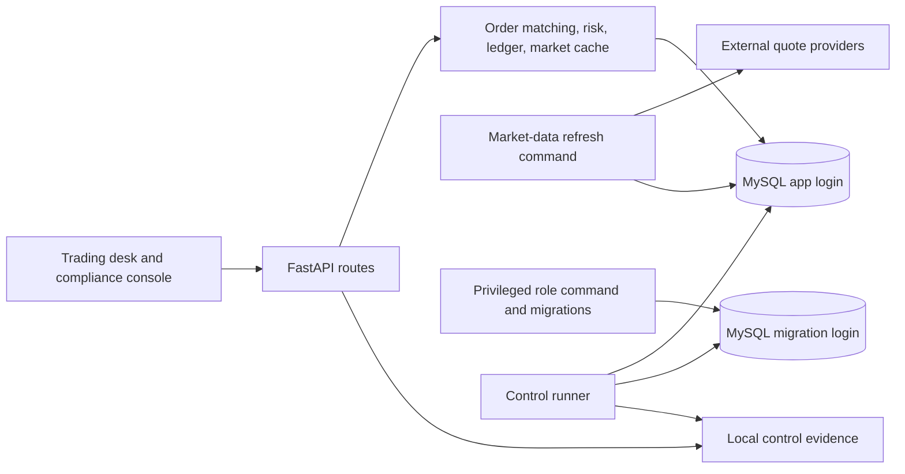

# Sentinel Markets architecture

This mock brokerage uses a React/Vite frontend, a FastAPI backend, and the existing MySQL database. PostgreSQL is planned but has not replaced MySQL. The [threat model](docs/THREAT_MODEL.md) shows the current trust boundaries.

Traders submit limit or market orders through `/orders/`, or direct quote-based trades through `/trades/`. Idempotency keys prevent duplicate submissions. The order book reserves cash or shares, matches by price and time, and records fills through the [double-entry ledger](docs/ledger.md). The database login used by the API cannot update or delete ledger entries.

The [market-data refresh command](docs/market-data.md) writes provider prices to the database cache. Trading checks reference that cache for freshness and price bands. A combined control runner checks database grants, role-change auditing, ledger integrity, market-data freshness, order price bands, and idempotency records. Evidence is written under ignored `grc/evidence/` and read by the compliance console.

Role changes require an admin request, approval by a different compliance officer, and a privileged operator command. Database triggers audit direct role updates. The app login cannot update roles or role-change records. See the [control matrix](grc/control_matrix.csv) and [current action items](docs/GRC_ACTION_ITEMS.md) for operating status and remaining gaps.
