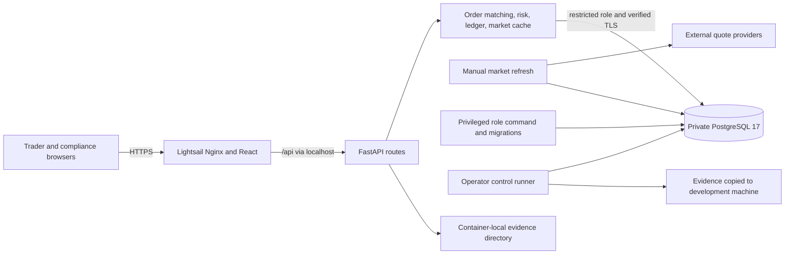

# Sentinel Markets architecture

This mock brokerage uses a React/Vite frontend, a FastAPI backend, and PostgreSQL 17. The public recruiter demo runs on AWS Lightsail in the selected Region `us-east-2`; its private database contains the verified copy of the local PostgreSQL data. The local Docker Compose database is a separate, clean development instance. The [threat model](docs/THREAT_MODEL.md) shows the trust boundaries, and the [AWS runbook](docs/aws_deployment.md) records the live resources and recovery path.

Traders submit limit or market orders through `/orders/`, or direct quote-based trades through `/trades/`. Idempotency keys prevent duplicate submissions. The order book reserves cash or shares, matches by price and time, and records fills through the [double-entry ledger](docs/ledger.md). The database login used by the API cannot update or delete ledger entries.

The [market-data refresh command](docs/market-data.md) writes provider prices to the database cache. Trading checks reference that cache for freshness and price bands. It was run once after AWS cutover. When `SCHEDULED_JOBS_ENABLED=true`, the API process repeats that refresh, reconciles the ledger, writes control results, and scans trades with surveillance rules that have an active database record. Evidence is inserted into append-only `control_evidence`. The console reads those rows. The active Lightsail image does not do this yet. A copy of the evidence outside the database remains open. The working tree also runs data-quality, intent, signal, and brief checks inside that same control pass. Those checks are not on the hosted image. The forecast is an advisory historical-volatility signal and does not change an order limit.

Surveillance rules live in versioned YAML under `grc/surveillance/`. The YAML file is not an activation. An admin or compliance officer requests a version, and a different admin or compliance officer approves it. The backtest scores labeled scenarios and does not open production cases. No rule is active on the hosted service, and the model-risk policy is still pending owner review.

Paper deposits and withdrawals, AML rules, a local sanctions fixture, and incident cases are in this working tree. AML YAML is not an activation. `YENTE_URL` is empty, so screening uses a one-name fixture that is not a sanctions list. SAR text is a template that cites the case event ids. It is not an external model, and it does not decide to file. Auditors can download a hashed evidence zip. The hosted image does not include these routes. The scheduled cycle in the working tree can also scan active AML rules. That flag is still off on the running service.

Sign-in can require a six-digit authenticator code. The secret is encrypted with `JWT_SECRET`. `MFA_REQUIRED` defaults to false, so an account with no factor can still sign in. An enrolled account completes a code before a session, and a large order from that account needs a current code. The working tree contains this path. The hosted image does not. Passkey signing is not implemented. The access-control policy is still pending owner review.

Role changes require an admin request, approval by a different compliance officer, and a privileged operator command. Database triggers audit direct role updates. The app login cannot update roles or role-change records. The AWS database has the same restricted grants and triggers; the latest hosted role and audit controls passed. See the [control matrix](grc/control_matrix.csv) and [current action items](docs/GRC_ACTION_ITEMS.md) for operating status and remaining gaps.
