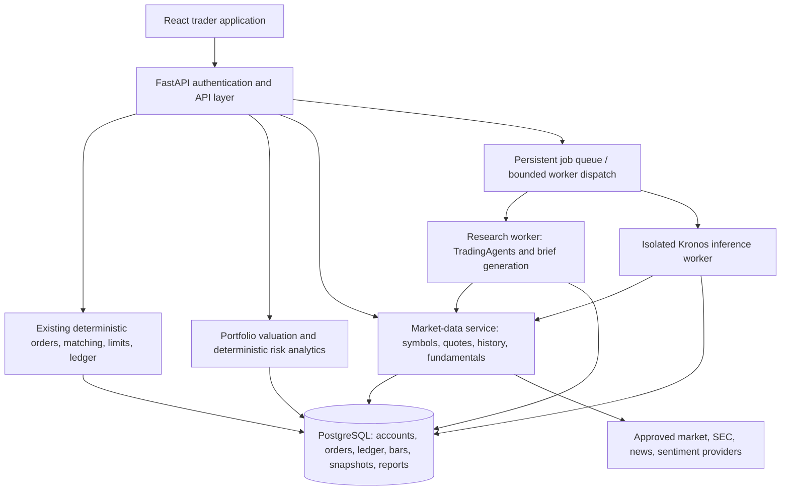

# Sentinel Markets 2.0 — Implementation Roadmap

**AI-enhanced paper trading, investment research, and portfolio risk intelligence**

| Document field | Value |
| --- | --- |
| Prepared | November 5, 2026 |
| Document status | Planning baseline; implementation status requires Phase 0 verification |
| Source | [Review Repo Assessment](chatgpt-conversation://6aebd6f5-5994-83ea-881d-2819872bb54f) |
| Delivery approach | Core trading product first; AI research and experimental forecasting afterward |
| Execution boundary | Paper trading only; backend controls remain authoritative |

> **Source fidelity:** The conversation reader returned the original detailed roadmap through the beginning of Phase 5, then truncated the message at 20,000 characters. Phases 0–4 below preserve and polish that retrieved material. Phase 5 retains the retrieved research workflow and architecture, with added implementation detail. Phases 6–7 and the supporting delivery sections are an editorial continuation based on the earlier conversation's stated forecasting and release goals, not a verbatim export of the unavailable ending. Proposed navigation fills a blank concept rendering in the source.

> **Status discipline:** This document does not certify the current repository or deployment. “Reported existing” means described as implemented in the source conversation, without fresh verification here. Every unchecked task and every API listed as proposed remains planned until evidence shows otherwise.

## Contents

- [Implementation status and evidence](#implementation-status-and-evidence)
- [Product scope](#product-scope)
- [Implementation priorities](#implementation-priorities)
- [Phase 0 — Baseline audit and stabilization](#phase-0--baseline-audit-and-stabilization)
- [Phase 1 — Rebuild the market-data foundation](#phase-1--rebuild-the-market-data-foundation)
- [Phase 2 — Redesign the trader-facing frontend](#phase-2--redesign-the-trader-facing-frontend)
- [Phase 3 — Build a professional trading terminal](#phase-3--build-a-professional-trading-terminal)
- [Phase 4 — Portfolio intelligence and interactive risk](#phase-4--portfolio-intelligence-and-interactive-risk)
- [Phase 5 — AI Research Desk](#phase-5--ai-research-desk)
- [Phase 6 — Experimental Forecast Lab](#phase-6--experimental-forecast-lab)
- [Phase 7 — Validation, hardening, and release](#phase-7--validation-hardening-and-release)
- [Target architecture](#target-architecture)
- [Integration guidance](#integration-guidance)
- [Proposed endpoint index and contracts](#proposed-endpoint-index-and-contracts)
- [Dependencies and priority ordering](#dependencies-and-priority-ordering)
- [Delivery evidence and release checklist](#delivery-evidence-and-release-checklist)
- [References and open decisions](#references-and-open-decisions)

## Implementation status and evidence

No product feature is marked newly completed by preparing this file.

| Capability | Status in the source conversation | What must be verified or built |
| --- | --- | --- |
| React 19, TypeScript, Vite, Tailwind, TanStack Query | Reported existing frontend stack | Confirm package versions, routes, deployed build, and supported browser behavior |
| FastAPI, SQLAlchemy, PostgreSQL 17, AWS Lightsail | Reported existing backend/deployment stack | Confirm running versions, migration state, capacity, and backup recovery |
| Authentication, order matching, limits, holdings, FIFO, ledger reconciliation | Reported existing | Regression-test and preserve; do not rebuild simply for a UI change |
| Market and limit orders | Reported existing | Verify exact lifecycle, cancellation, reservations, idempotency, and authorization |
| Nasdaq symbol discovery, Yahoo daily bars, SEC fundamentals, quote cache | Reported existing components | Validate actual universe, history retention, provider rights, freshness, and outages |
| November 4 quote refresh: 180 quotes | Historical claim in the source | A quote refresh does not prove complete historical OHLCV coverage |
| Holdings, cash, cost basis, realized/unrealized P&L at `/portfolio/` | Reported existing | Verify reconciliation and replace per-holding price fetching with a bulk snapshot |
| Existing `/risk/` | Reported mainly post-trade | Portfolio analytics and pre-trade simulation remain proposed |
| 134 backend tests; nine frontend tests | Reported historical counts | Rerun at a recorded commit; counts alone do not establish current coverage |
| Bluesky: eight seeded signal accounts | Source describes an unresolved integration | Establish whether these are research sources; do not equate them with brokerage users |
| Two-year OHLCV store, normalized data APIs, advanced charts | Proposed | Phases 1–3 |
| Redesigned shell, discovery, persistent watchlists | Proposed | Phases 2–3; audit any partial implementation first |
| Portfolio time series, quantitative risk, Trade Impact Preview | Proposed | Phase 4 |
| TradingAgents, daily_stock_analysis research integration | Proposed | Phase 5 |
| Kronos Forecast Lab | Proposed and experimental | Phase 6; validation can block user-facing release |
| Impeccable, Taste Skill, Chrome DevTools MCP | Proposed development aids | Review and use during implementation; not end-user runtime features |
| Stop orders, intraday feeds, Strategy Lab | Later or separately gated | Do not advertise as working in the core release |

Phase 0 must replace “reported existing” with evidence-backed classifications: **verified deployed**, **implemented locally**, **partial**, **documented only**, or **proposed**. Record the commit, environment, verification date, test evidence, and remaining gaps.

---

**Objective:** Transform Sentinel Markets from a backend-heavy mock brokerage into a polished, AI-enhanced paper-trading, investment research, and portfolio risk platform—without discarding the substantial backend engineering already completed.

The new product should combine the usability of Robinhood, charting sophistication of TradingView, AI research workflows inspired by TradingAgents, and quantitative forecasting through Kronos.

The primary change is architectural and experiential: **the trader-facing application becomes the product, while the existing backend becomes its infrastructure.**

## Product scope

Existing security, deterministic risk controls, order matching, ledger, and compliance services remain protected backend capabilities.

### Product boundaries

**In scope:** US equity and ETF paper trading, historical market data, professional charts, portfolio accounting, AI-assisted investment research, forecasting experiments, trade-impact simulations, and portfolio risk analytics.

**Out of scope for this implementation:** Real-money brokerage execution, autonomous AI trading, derivatives, margin, options, cryptocurrency trading, additional regulatory frameworks, and a major redesign of the existing compliance backend.

This scope is intentional. The previous expansion became too broad, and a strict product boundary is necessary to prevent the same problem from recurring.

## Implementation priorities

**Recommended delivery rule:** Phases 0–4 form the core trading product. Phases 5–6 add advanced functionality. Phase 7 is the final release gate, although testing and security review must happen throughout.

The public frontend must become useful before spending significant resources on LLM orchestration or machine-learning inference.

---

## Phase 0 — Baseline audit and stabilization

**Status:** Proposed work; unchecked tasks are not implementation claims.\
**Dependencies:** None. Verify the current code, database, and deployment before changing behavior.

**Goal:** Establish a reliable baseline for the system before modifying its interface or adding dependencies.

The source conversation reports a stack of React 19, TypeScript, Vite, Tailwind CSS, TanStack Query, FastAPI, SQLAlchemy, PostgreSQL 17, and AWS Lightsail.

The source reports existing support for order matching, trading limits, portfolio holdings, FIFO accounting, ledger reconciliation, and market discovery. We should preserve these components.

### Workstreams

- [ ] Inventory all existing React routes, components, page layouts, and API requests.
- [ ] Map the current authentication, market, portfolio, orders, trades, and risk endpoints.
- [ ] Record which features are deployed, locally implemented, partially implemented, or only documented.
- [ ] Reconcile the latest deployed frontend with the current GitHub `main` branch.
- [ ] Test a complete authenticated paper-trading journey in a real browser.
- [ ] Verify existing users and account data after the PostgreSQL migration.
- [ ] Investigate the Bluesky integration: determine whether the eight seeded signal accounts should become approved research sources, and keep that distinct from brokerage-user accounts.
- [ ] Confirm the status of historical price data, quote-cache freshness, and stock-universe completeness.
- [ ] Create a baseline database backup and documented rollback procedure.
- [ ] Freeze unrelated GRC expansion work during the frontend modernization.

### Specific defects and risks to investigate

The earlier assessment reports that `/portfolio/` retrieves prices separately while iterating through holdings. That can create inconsistent valuation timestamps and unnecessary provider requests. It should use a bulk pricing snapshot from the market-data layer.

The earlier assessment reports that `/risk/` largely returns post-trade risk assessments. It does not yet provide the portfolio-wide quantitative analytics or pre-trade simulation needed by the new UI.

The source conversation reports 134 passing backend tests and nine frontend tests; these counts have not been rerun for this document. Those are useful foundations, but frontend end-to-end coverage is still relatively limited.

### Deliverables

`docs/PRODUCT_V2.md`, `docs/FRONTEND_AUDIT.md`, `docs/API_INVENTORY.md`, and a prioritized migration backlog.

**Exit criterion:** A verified deployment baseline with working authentication, preserved holdings and trades, reconciled account data, and a clearly documented list of functional and UI gaps.

---

## Phase 1 — Rebuild the market-data foundation

**Status:** Proposed work; unchecked tasks are not implementation claims.\
**Dependencies:** Phase 0 baseline and provider access. Blocks production chart data, quantitative risk, forecasting, and reliable backtests.

(Blocking dependency for charts, backtesting and forecasting)

**Goal:** Ensure every market-facing feature can retrieve dependable historical data rather than depending on a small collection of cached closing quotes.

The source describes existing Nasdaq symbol discovery, Yahoo daily bars, SEC fundamentals, and a quote cache. The source reports that the November 4 deployment refreshed 180 quotes, but that does not constitute a full historical backfill.

### 1.1 Historical OHLCV pipeline

Store historical *Open, High, Low, Close, Volume* bars in PostgreSQL using an explicit schema.

| Field | Purpose |
|--------|--------|
| `symbol` | Canonical security identifier |
| `interval` | 1d, 1h, 5m, etc., where supported |
| `bar_time` | Exchange-aware observation timestamp |
| `open`, `high`, `low`, `close` | Historical price data |
| `volume` | Trading volume |
| `provider` | Source of the data |
| `fetched_at` | Time the data was retrieved |
| `adjustment_type` | Raw or corporate-action-adjusted series |
| `quality_status` | Valid, flagged, or rejected |

Use a unique constraint covering the security, interval, timestamp, and relevant series identity to prevent duplicate bars.

Separate research-adjusted prices from execution reference prices. Splits and dividends must be handled consistently to avoid distortions in returns, chart history, and backtests.

### 1.2 Data ingestion

- [ ] Backfill at least two years of daily OHLCV for a defined initial stock universe.
- [ ] Include all assets held in existing user portfolios.
- [ ] Include major index ETFs and a curated liquid-stock universe.
- [ ] Implement incremental daily updates instead of repeatedly downloading complete histories.
- [ ] Detect missing sessions, duplicate bars, invalid OHLC relationships, and anomalous price gaps.
- [ ] Persist provider metadata and bar provenance.
- [ ] Reconcile conflicting provider data.
- [ ] Implement cache freshness and controlled retries.
- [ ] Separate market-data fetching from frontend API response handling.

Start with daily bars. Intraday feeds can follow once provider licensing, cost, and coverage are established. Never label daily closing data as real-time quotes.

### 1.3 Market-data API

Proposed endpoints:

```text
GET /market/search?q=NVDA
GET /market/symbols/NVDA
GET /market/symbols/NVDA/quote
GET /market/symbols/NVDA/history?interval=1d&range=2y
GET /market/symbols/NVDA/indicators?...
GET /market/movers
GET /market/sectors
GET /market/data-status
```

These are new or normalized API contracts to implement, not claims about routes currently available.

### Acceptance criteria

- Historical bars load reliably for the initial supported universe.
- Every portfolio holding has a usable valuation source or an explicit unavailable status.
- Invalid, stale, or incomplete data is clearly identified.
- Duplicate ingestion is idempotent.
- Charts, risk calculations, and backtests consume consistent, versioned historical data.
- Data-provider outages do not silently produce fabricated prices.

**Deliverable:** A complete historical market-data foundation suitable for advanced charting and quantitative analytics.

---

## Phase 2 — Redesign the trader-facing frontend

**Status:** Proposed work; unchecked tasks are not implementation claims.\
**Dependencies:** Phase 0 API inventory. Design work can overlap Phase 1; live widgets depend on its usable data, Phase 3 watchlists, and Phase 4 performance history.

**Goal:** Make Sentinel Markets visually and functionally recognizable as a modern trading platform.

### Target navigation

```text
Overview · Markets · Trade · Portfolio · Research · Risk Lab · Activity
Later: Forecast Lab · Strategy Lab (separately scoped)
Account Settings | Administration & Compliance (role-gated)
```

Account settings and a separate role-gated Administration & Compliance workspace remain accessible without dominating trader navigation.

### 2.1 Design system

Use `pbakaus/impeccable` to critique existing UI and establish consistency, with `Leonxlnx/taste-skill` as design guidance.

Define reusable foundations for typography, colors, spacing, tables, badges, chart styling, forms, dialogs, and loading states.

Adopt a dark-first aesthetic with restrained color: green and red only for gains, losses, buys, and sells; muted surfaces elsewhere. Maintain accessible contrast and a functional light theme if supported.

### 2.2 Overview dashboard

Build an immediately understandable signed-in landing page containing:

- Total account value, cash, buying power, and daily/total P&L.
- A portfolio equity curve with selectable periods.
- Major index performance.
- Market movers and sector activity.
- Watchlist price changes.
- Top portfolio winners and losers.
- Recent trades and orders.
- Compact research insights.

Every widget must handle loading, empty, stale-data, and error states.

### 2.3 Market discovery

Create a dedicated stock-discovery experience with search, sector filters, watchlists, trending assets, company profiles, and an interactive heatmap.

Users should be able to navigate directly from the dashboard to a stock page without losing context.

### 2.4 Frontend architecture

Proposed feature-based organization:

```text
frontend/src/
  app/
    layouts/
    routes/
    providers/
  components/
    ui/
    charts/
    tables/
    feedback/
  features/
    dashboard/
    markets/
    trading/
    portfolio/
    research/
    risk/
    strategies/
    activity/
    compliance/
  lib/
    api/
    formatting/
    dates/
    validation/
  hooks/
  types/
```

Use the existing TanStack Query integration for server-state caching and invalidation. Don't introduce another global state solution unless there is an identified need.

### Acceptance criteria

- The application is responsive across desktop, tablet, and mobile.
- Core trader journeys require fewer unnecessary navigation steps.
- Trading and compliance workspaces are clearly separated by role.
- Core financial information is understandable without opening additional screens.
- No new page depends on hardcoded or silently fabricated portfolio values.

**Deliverable:** A visually coherent Sentinel Markets 2.0 frontend shell with functioning overview and market-discovery pages.

---

## Phase 3 — Build a professional trading terminal

**Status:** Proposed work; unchecked tasks are not implementation claims.\
**Dependencies:** Phase 1 historical data and Phase 2 shell. Reuse the existing authenticated order APIs and matching engine.

**Goal:** Replace the basic trade-entry experience with a complete, chart-centered trading workspace.

### 3.1 Advanced charting

Integrate [TradingView Lightweight Charts](https://github.com/tradingview/lightweight-charts) into React.

Core chart features:

- [ ] Candlestick, line, and area chart modes.
- [ ] Historical timeframes: 1M, 3M, 6M, 1Y, 2Y, and All.
- [ ] Volume histogram and crosshair price inspection.
- [ ] SMA, EMA, Bollinger Bands, RSI, and MACD.
- [ ] User-configurable indicator parameters.
- [ ] Trade execution markers on historical charts.
- [ ] Price levels for open limit orders.
- [ ] Persisted chart preferences.
- [ ] Responsive resizing and performance optimization.

Intraday resolutions such as 1m, 5m, and 1h should only be enabled once the market-data pipeline reliably supports them.

### 3.2 Integrated order ticket

Make the order ticket available directly beside the chart.

The initial version should expose the existing market and limit order functionality without changing the underlying matching engine.

It should show available buying power, shares held, estimated order value, reference-price freshness, and relevant trading restrictions.

Implement an order-preview step, then final submission.

```text
Select stock
    ↓
Inspect chart and fundamentals
    ↓
Choose BUY or SELL
    ↓
Enter quantity and order type
    ↓
Preview cost, buying power and limits
    ↓
Confirm paper order
    ↓
Backend executes deterministic checks
    ↓
Show accepted, open, partially filled,
filled, canceled or rejected status
```

The preview must be labeled non-binding: execution-time validation remains authoritative.

### 3.3 Order lifecycle and chart integration

- [ ] Create and cancel orders.
- [ ] Display open, partially filled, filled, canceled, and rejected orders.
- [ ] Show individual execution fills and their timestamps.
- [ ] Reflect changes to cash reservations and holdings.
- [ ] Use idempotency keys on order submissions.
- [ ] Refresh order state automatically through controlled polling or server push.
- [ ] Plot fills and active orders on charts.
- [ ] Provide clear rejection reasons and actionable error messages.

Do not imply instantaneous market fills. The existing simulator matches eligible opposing orders, and a market order may remain unfilled if there is no suitable liquidity. This behavior needs to be explained clearly in the UI.

### 3.4 Watchlists

Introduce persistent, user-scoped watchlists.

Suggested endpoints:

```text
GET    /watchlists
POST   /watchlists
PATCH  /watchlists/{id}
DELETE /watchlists/{id}

POST   /watchlists/{id}/symbols
DELETE /watchlists/{id}/symbols/{symbol}
```

Support multiple lists, symbol removal, sorting, and navigation into research/trading.

### 3.5 Optional later additions

Stop-loss, stop-limit, and take-profit orders are worthwhile but require new trigger semantics, pricing rules, and tests. They should be delivered as a later trading-engine extension rather than being presented as a frontend-only task.

### Acceptance criteria

A user can discover a stock, view historical charts and technical indicators, place a supported paper order, observe order status, cancel an open order, and inspect completed fills without navigating through administrative pages.

**Deliverable:** The first complete Sentinel Markets professional trading workspace.

---

## Phase 4 — Portfolio intelligence and interactive risk

**Status:** Proposed work; unchecked tasks are not implementation claims.\
**Dependencies:** Phases 0–1 data and accounting baseline; Phase 3 provides the integrated order-ticket surface.

**Goal:** Transform the existing holdings and risk endpoints into an analytical experience comparable to the portfolio tools of a mature brokerage.

### 4.1 Portfolio performance engine

The source reports that `/portfolio/` exposes holdings, cost basis, cash balance, and realized/unrealized P&L.

What it lacks is a complete portfolio time series.

Develop a portfolio valuation engine that reconstructs performance over time using cash movements, holdings, executions, and historical prices.

The calculations must distinguish investment returns from deposits and withdrawals.

Add:

- [ ] Daily portfolio valuations.
- [ ] Time-weighted returns.
- [ ] Money-weighted returns where cash-flow history permits.
- [ ] Cumulative and daily P&L.
- [ ] FIFO realized gain/loss breakdown.
- [ ] Performance by position and asset.
- [ ] Comparison with SPY or another benchmark.
- [ ] Historical drawdowns.
- [ ] Portfolio allocation by security and sector.

### 4.2 Quantitative risk engine

Implement deterministic risk metrics before introducing machine-learning-based forecasts.

| Metric | Planned calculation |
|--------|--------|
| Historical volatility | Standard deviation of historical returns |
| Portfolio beta | Regression or covariance against a defined benchmark |
| Historical VaR | Empirical loss quantile at 95% and 99% |
| Expected Shortfall | Mean of losses beyond the VaR cutoff |
| Maximum drawdown | Largest peak-to-trough portfolio decline |
| Concentration | Security and sector weights |
| Correlation | Pairwise return correlation |
| Risk contribution | Marginal/component contribution using the portfolio risk model |
| Stress-test loss | Revaluation under defined market shock scenarios |

Clearly document return frequency, lookback window, treatment of missing prices, confidence levels, and model limitations.

### 4.3 Trade Impact Preview

This should become one of the signature features.

Before submitting an order, Sentinel Markets calculates how the proposed trade would affect the user's current portfolio.

**Trade Impact Preview** (Illustrative values)

| Metric | Before | After |
|--------|--------|--------|
| NVDA allocation | 12.0% | 17.0% |
| Technology exposure | 38.0% | 43.0% |
| Portfolio volatility | 18.2% | 19.1% |
| 95% one-day VaR | $1,840 | $2,020 |
| Buying power | $25,000 | $20,000 |

Example assumes a $5,000 purchase financed from existing cash in a $100,000 portfolio. The figures illustrate the interface and are not computed from a live account.

This feature requires its own computation service:

```text
POST /portfolio/trade-impact
```

Input: symbol, side, quantity, proposed reference price, and order type.

Output: baseline portfolio metrics, hypothetical post-trade metrics, changes, data timestamps, assumption disclosures, and applicable limit warnings.

The preview must never mutate cash, holdings, or orders.

### 4.4 Risk Lab

Develop an interactive scenario-analysis workspace.

Users should be able to select a scenario and immediately see how their holdings would respond.

Examples include:

- Broad equity-market correction.
- Technology-sector selloff.
- Interest-rate shock assumptions.
- Single-security drawdown.
- Historical crisis-style scenarios, using clearly defined historical windows.
- Custom simultaneous security or sector shocks.

### 4.5 Risk APIs

```text
GET  /portfolio/performance
GET  /portfolio/allocation
GET  /portfolio/attribution
GET  /portfolio/risk-metrics
POST /portfolio/trade-impact
POST /risk/scenarios
```

### Acceptance criteria

- Portfolio valuations reconcile with cash and position records.
- Cash deposits are not incorrectly counted as investment returns.
- VaR and other measures have deterministic reference tests.
- Risk simulations do not modify account balances.
- Missing or insufficient market history produces an explicit unavailable result rather than a misleading estimate.
- All metrics display their assumptions, periods, and source timestamps.

**Deliverable:** A functional portfolio analytics and risk simulation suite, tightly integrated into trading.

---

## Phase 5 — AI Research Desk

**Status:** Proposed. Retrieved source workflow and worker architecture, expanded into an actionable checklist.\
**Dependencies:** Phase 1 trusted market history and fundamentals, Phase 2 research UI, authenticated user ownership, approved news access, and persistent background jobs. Phase 4 is required for portfolio-aware explanations.

**Goal:** Give users a stock-research workflow with visible evidence, competing interpretations, and clear limitations.

### 5.1 Research workflow and user experience

Use [TradingAgents](https://github.com/TauricResearch/TradingAgents) for the multi-agent research approach and selected [daily_stock_analysis](https://github.com/ZhuLinsen/daily_stock_analysis) patterns for watchlist briefs. Both integrations are proposals.

```text
Select symbol, research date, and analysis options
    ↓
Collect and validate prices, fundamentals, filings, and dated news
    ↓
Fundamental / technical / news / approved sentiment perspectives
    ↓
Bull thesis ↔ Bear thesis
    ↓
Synthesis: evidence, disagreements, risks, assumptions, and conclusion
    ↓
Stored report → Research Desk → optional user-opened paper-order ticket
```

- [ ] Build a research request form with symbol, as-of date, scope, and clear expected job status.
- [ ] Show queued, running, succeeded, failed, and canceled states with retry guidance.
- [ ] Render a concise synthesis alongside expandable analyst sections and bull/bear arguments.
- [ ] Attach dated source links and distinguish source facts from generated interpretation.
- [ ] Show input freshness, report creation time, missing evidence, model identity, and report version.
- [ ] Provide report history and saved reports scoped to the authenticated user.
- [ ] Let users open a prefilled order ticket; keep order confirmation and execution validation separate.
- [ ] Keep reports useful when optional sentiment or news sources fail; visibly label incomplete coverage.

### 5.2 Worker integration

The source proposes asynchronous research jobs rather than running an entire multi-agent workflow inside a synchronous FastAPI request.

```text
React Research Desk
    → FastAPI Research API
    → Persistent job queue
    → Bounded TradingAgents worker
        → Sentinel Market Data Service
        → SEC fundamentals / filings
        → Approved news and sentiment sources
    → Structured report in PostgreSQL
    → React report viewer
```

- [ ] Review the upstream license, dependencies, runtime requirements, and actual callable interface at a pinned revision.
- [ ] Prefer the upstream TradingAgents project over an older fork unless a documented requirement justifies the fork.
- [ ] Add a narrow integration boundary around stock research; do not import a second brokerage or portfolio authority.
- [ ] Persist job ownership, inputs, timestamps, attempt count, status, error category, and result identifier.
- [ ] Use bounded concurrency, retry limits, timeouts, cancellation, and restart recovery.
- [ ] For a prototype, use a bounded worker with persistent job state; for reliable deployment, run a separate worker process with durable queue semantics.
- [ ] Cache only compatible reports using symbol, as-of cutoff, source snapshot, analysis configuration, model, and prompt version.
- [ ] Keep private portfolio context out of shared report caches.
- [ ] Enforce per-user quotas and per-job token/cost limits.
- [ ] Keep provider credentials server-side and redact sensitive payloads from logs.
- [ ] Sanitize report Markdown and treat retrieved web/news content as untrusted data.
- [ ] Restrict tools to approved research reads; disable execution paths that can submit orders.
- [ ] Do not expose a whole account when a summary of required holdings and metrics is sufficient.

Proposed report fields: `report_id`, `job_id`, `symbol`, `as_of`, `created_at`, `input_snapshot_id`, `analyst_sections`, `bull_case`, `bear_case`, `synthesis`, `risks`, `sources`, `missing_data`, `model_version`, and `prompt_version`.

### 5.3 Personalized daily briefs

Use daily_stock_analysis as a source of selected aggregation and reporting patterns. Reuse Sentinel's market-data service, account ownership, and report storage.

- [ ] Select watched stocks and, where authorized, held assets for the daily brief.
- [ ] Define a trading-calendar-aware schedule and the data cutoff for each brief.
- [ ] Combine verified price changes, relevant filings/news, and linked research summaries.
- [ ] Deduplicate analysis across eligible symbols without sharing private user context.
- [ ] Store the brief date, universe, input cutoff, source links, and generation status.
- [ ] Display briefs in the application first; external email or chat delivery is a separate opt-in scope.
- [ ] Prevent duplicate scheduled runs and allow controlled recovery after failures.
- [ ] Keep Bluesky sources optional until approved, evaluated, and separated from customer identities.

### 5.4 Proposed research APIs

```text
POST /research/jobs
GET  /research/jobs/{job_id}
POST /research/jobs/{job_id}/cancel
GET  /research/reports
GET  /research/reports/{report_id}
GET  /research/briefs
GET  /research/briefs/{brief_id}
```

Return a job identifier promptly; the UI polls the job endpoint with bounded intervals. Do not leave a browser request waiting through a complete research run.

### Exit criteria

- [ ] A user can request, monitor, retrieve, and revisit a grounded report.
- [ ] Another user cannot read the job, report, brief, or private context.
- [ ] Claims can be traced to dated evidence; missing evidence is visible.
- [ ] Worker failure, timeout, provider outage, and retry behavior are tested.
- [ ] Report generation cannot mutate orders, holdings, or cash.
- [ ] A daily watchlist brief is reproducible from recorded inputs and does not duplicate runs.
- [ ] Measured latency, resource use, and cost fit an agreed operating budget.

**Deliverable:** An asynchronous Research Desk with stored bull/bear reports and personalized in-app briefs.

---

## Phase 6 — Experimental Forecast Lab

**Status:** Proposed editorial continuation; the source ending was unavailable. The earlier conversation explicitly identifies Kronos as the forecasting candidate.\
**Dependencies:** Phase 1 clean, versioned OHLCV; Phase 3 charts; Phase 5 job infrastructure or equivalent shared worker lifecycle; isolated inference capacity and evaluation data.

**Goal:** Let users inspect model-generated price scenarios alongside historical data without suggesting that generated paths are known future prices.

### 6.1 Kronos evaluation and inference

[Kronos](https://github.com/shiyu-coder/Kronos) provides a financial time-series model and tokenizer for candlestick sequences. Treat the repository and model weights as separately reviewable dependencies.

- [ ] Pin a model, matching tokenizer, code revision, and weight revision.
- [ ] Verify code and model licenses, redistribution terms, and hardware requirements.
- [ ] Start with daily data and a small supported symbol set.
- [ ] Validate chronological ordering, required columns, adjustment convention, context length, and missing sessions.
- [ ] Make future timestamps follow exchange trading sessions.
- [ ] Persist input cutoff, dataset version, lookback, horizon, seed, sampling settings, model revision, and output paths.
- [ ] Bound history length, forecast horizon, sampling count, runtime, memory, and concurrent jobs.
- [ ] Reject incompatible or insufficient inputs with a readable error.
- [ ] Keep inference outside the order API process; measure actual CPU/GPU memory and latency before choosing hosting.
- [ ] Use a shared job lifecycle where possible; do not build a second general-purpose queue.
- [ ] Cache only when model, inputs, adjustment rules, and generation settings match.

### 6.2 Chart experience

- [ ] Separate observed bars from generated paths with a visible cutoff marker.
- [ ] Provide a forecast toggle, supported horizon selector, generation date, and model information.
- [ ] Show sampled paths or empirical scenario ranges if produced by the selected implementation.
- [ ] Do not label sampled-path dispersion as a calibrated confidence interval without coverage evaluation.
- [ ] Include input freshness, supported universe, and a clear experimental label.
- [ ] Keep historical charts and trading usable when inference is disabled or unavailable.
- [ ] Prevent forecast output from triggering orders, overriding deterministic limits, or changing execution prices.

### 6.3 Historical validation

- [ ] Define an evaluation protocol before tuning parameters.
- [ ] Evaluate rolling or walk-forward windows with inputs restricted to each historical cutoff.
- [ ] Compare with simple baselines such as last observed close or a documented random-walk baseline.
- [ ] Report errors by symbol, horizon, period, and market regime; disclose sample sizes.
- [ ] Measure price error, directional accuracy, and empirical interval coverage where appropriate.
- [ ] Check corporate-action handling, missing-data treatment, and potential survivorship bias.
- [ ] Document possible overlap between pretrained model data and evaluation periods; do not claim clean out-of-sample evidence when training-data coverage is unknown.
- [ ] Separate forecasting accuracy from trading profitability; profitable simulation is not established by a good price-fit metric.
- [ ] Retain failed evaluations and weak results; avoid selecting only attractive examples.

### 6.4 Proposed forecast APIs

```text
POST /forecasts/jobs
GET  /forecasts/jobs/{job_id}
POST /forecasts/jobs/{job_id}/cancel
GET  /forecasts/{forecast_id}
GET  /forecasts/models
GET  /forecasts/evaluations
```

A request identifies symbol, interval, as-of cutoff, lookback, and a supported horizon. The server chooses an approved model/configuration. Results include observed-input metadata, forecast timestamps, scenario paths or summaries, validation context, and limitations.

### Exit criteria

- [ ] A forecast can be recreated from recorded inputs and generation settings within documented reproducibility limits.
- [ ] The chart makes historical observations and generated scenarios unmistakable.
- [ ] Walk-forward results and baseline comparisons are reviewed before broad exposure.
- [ ] Forecast jobs have bounded cost and resources and do not impair paper trading.
- [ ] Inadequate evaluation, licensing, or capacity leaves the feature disabled or limited to an internal experiment.
- [ ] No forecast output can autonomously execute a trade.

**Deliverable:** A feature-gated Forecast Lab with documented evaluation results and an isolated inference worker.

### Optional Strategy Lab — separately scoped

Historical strategy backtesting was discussed as a future extension. It is not evidence of an implemented feature or a prerequisite for the core trading release.

If commissioned, choose one primary engine after evaluating existing dependencies and licensing; candidate approaches mentioned earlier were vectorbt or Backtrader. Define execution timing, fees, slippage, liquidity, benchmark, and point-in-time inputs. Test look-ahead bias, cash accounting, and corporate actions before publishing results. Do not install multiple engines without a specific need.

---

## Phase 7 — Validation, hardening, and release

**Status:** Proposed editorial continuation. The retrieved source explicitly identifies Phase 7 as the final release gate and requires testing throughout.\
**Dependencies:** Verified core Phases 0–4. Apply additional gates to Phases 5–6 only when included in the release; advanced features can remain disabled.

**Goal:** Ship a coherent trader-facing product while preserving accounting, access control, and order behavior.

### 7.1 Functional and regression coverage

- [ ] Re-run the backend and frontend suites at the release commit and record the actual results.
- [ ] Cover login, expired sessions, role-gated administration, and user data isolation.
- [ ] Test search → symbol → chart → preview → submit → order state → fill/cancel → portfolio.
- [ ] Test both market and limit orders, partial fills, insufficient liquidity, rejections, reservations, and duplicate submissions.
- [ ] Reconcile holdings, cash, realized P&L, FIFO lots, and the ledger after completed and canceled orders.
- [ ] Verify watchlist ownership and persistence.
- [ ] Exercise stale, missing, invalid, rate-limited, and unavailable market data.
- [ ] Verify simulations cannot mutate accounts.
- [ ] Test applicable research and forecast timeout, cancellation, restart, and retry cases.
- [ ] Keep deterministic fixtures for return calculations, VaR/ES, benchmark alignment, and cash-flow treatment.

### 7.2 Browser quality and accessibility

Use [Chrome DevTools MCP](https://github.com/ChromeDevTools/chrome-devtools-mcp) during development for browser inspection, console/network diagnosis, and performance traces. Keep durable regression checks in the existing test setup; manual tool use alone is not a repeatable test suite.

- [ ] Review desktop, tablet, and mobile layouts with real rendered data.
- [ ] Verify keyboard navigation, focus management, labels, contrast, dialog behavior, and non-color status cues.
- [ ] Supply textual summaries or accessible tabular equivalents for important chart information.
- [ ] Check loading, empty, stale, permission-denied, and error states.
- [ ] Confirm charts resize cleanly, release resources on unmount, and avoid duplicate subscriptions.
- [ ] Inspect unexpected network requests, console errors, and sensitive values in client output.
- [ ] Record representative chart interactions and page-load traces against a repeatable dataset.

### 7.3 Security, data integrity, and operational readiness

- [ ] Review authentication, account ownership, input validation, rate limits, and server-side order controls.
- [ ] Verify order idempotency and transaction handling under retries and concurrent requests.
- [ ] Confirm research tools cannot access order mutations or unrestricted secrets.
- [ ] Review third-party licenses, notices, dependency vulnerabilities, and data-provider usage rights.
- [ ] Use least-privilege worker credentials and redact tokens and private portfolio contents from logs.
- [ ] Monitor data freshness, ingestion failures, reconciliation failures, API latency/errors, job age, retries, and AI cost.
- [ ] Measure API, database, and worker resource usage separately.
- [ ] Confirm backups restore into a test environment and document rollback boundaries.
- [ ] Exercise provider outages, worker restarts, and database connection failures without losing accepted work.
- [ ] Define operating budgets and alert thresholds before enabling costly AI workloads.

### 7.4 Rollout

- [ ] Deploy additive, backward-compatible database changes before dependent UI changes.
- [ ] Backfill data in bounded batches and reconcile existing accounts.
- [ ] Validate the release in staging using representative, non-sensitive test accounts.
- [ ] Release the core terminal and portfolio experience first.
- [ ] Enable Research Desk and Forecast Lab separately after their gates pass.
- [ ] Retain a tested rollback path for application code and a safe forward-repair plan for data changes.
- [ ] Publish known limitations: daily versus intraday coverage, simulated liquidity, data delays, and experimental model behavior.
- [ ] Complete an end-to-end smoke test against the actual deployed release.
- [ ] Record the deployed version, migration version, enabled features, and remaining issues.

### Exit criteria

- [ ] No unresolved release-blocking defects affecting account integrity, security, or core paper-trading journeys.
- [ ] Portfolio and ledger reconciliation passes on representative accounts.
- [ ] Core journeys work in the deployed browser experience with accessible controls.
- [ ] Data-quality failures and job failures are visible and recoverable.
- [ ] Backup restoration, deployment rollback, monitoring, and operational ownership are documented.
- [ ] Optional AI capabilities are either validated and enabled or explicitly disabled.
- [ ] Release documentation clearly separates shipped, partial, and deferred features.

**Deliverable:** A validated Sentinel Markets 2.0 release with operational runbooks and evidence-backed release notes.

---

## Target architecture

**Status:** Proposed composition around the reported existing backend. It does not imply that these services, workers, or tables have been deployed.



Research and forecasting have no direct execution arrow. A user must submit a paper order through the authenticated API, where existing deterministic checks remain authoritative.

### Responsibility boundaries

| Layer | Owns | Must not do |
| --- | --- | --- |
| React and TanStack Query | Display, navigation, input, state refresh | Invent account values or bypass server authorization |
| Trading services | Order validation, matching, reservations, fills, ledger | Depend on LLM availability or forecast conclusions |
| Market-data service | Provider adapters, freshness, canonical history, provenance | Hide outages behind fabricated prices |
| Portfolio/risk services | Consistent valuation snapshots and deterministic calculations | Mutate accounts during simulations |
| Research worker | Evidence collection and structured synthesis | Execute orders or become the cash/holdings authority |
| Forecast worker | Versioned model inference and evaluation artifacts | Treat generated paths as execution quotes |
| Developer tools | Design review, browser inspection, debugging | Become required product runtime services |

### Proposed persistence additions

Audit existing models before creating new ones. Reuse an adequate table rather than duplicate its responsibility.

| Record family | Minimum purpose | Phase |
| --- | --- | --- |
| Historical bars and ingestion status | Canonical OHLCV, series identity, provenance, missing/flagged data | 1 |
| Watchlists and members | User-owned lists, unique membership, order/sort preferences | 3 |
| Chart preferences | User-owned display settings; no sensitive trading state | 3 |
| Valuation snapshots and calculation metadata | Reproducible portfolio history with source timestamps | 4 |
| Jobs and attempts | Ownership, status, retries, recovery, cancellation, errors | 5; reused in 6 |
| Research reports and daily briefs | Versioned content, sources, cutoff dates, private context scope | 5 |
| Forecast runs and evaluation summaries | Model/data versions, configuration, outputs, quality evidence | 6 |

Keep money calculations in the existing precise numeric representation. Use consistent UTC timestamps plus exchange-session information; daily bars need an explicit trading-date convention. Preserve original executions and ledger entries as the accounting source of truth.

---

## Integration guidance

The following is a proposed implementation plan. Repository descriptions are based on their official pages; no package, skill, worker, or MCP server was installed while preparing this document.

| Integration | Role | Integration boundary | Phase |
| --- | --- | --- | --- |
| TradingView Lightweight Charts | Product runtime chart rendering | React chart component fed by Sentinel APIs | 3 |
| TradingAgents | Research workflow candidate | Bounded background worker; structured report contract | 5 |
| daily_stock_analysis | Daily brief and aggregation patterns | Selected components adapted to shared data/report services | 5 |
| Kronos | Experimental time-series forecasting | Separate inference worker and evaluation pipeline | 6 |
| Impeccable | Developer design critique and polish | Review existing components against one design system | 2 and 7 |
| Taste Skill | Developer art direction | Selectively inform hierarchy, spacing, and visual consistency | 2 |
| Chrome DevTools MCP | Developer browser debugging and performance | Test environment/profile with controlled browser access | 0–7 |

### TradingView Lightweight Charts

[Official repository](https://github.com/tradingview/lightweight-charts)

Use the library for financial chart rendering; build Sentinel-specific indicators, preferences, order overlays, and data fetching around it. It does not supply the market-data pipeline or a complete brokerage terminal.

- [ ] Pin a supported stable version and follow the API for that version.
- [ ] Review license, NOTICE, attribution, and any required TradingView link before release.
- [ ] Use one chart lifecycle component with reliable initialization, resize, and cleanup.
- [ ] Normalize timestamps and sort/deduplicate bars before supplying chart data.
- [ ] Compute indicators from adequate history; use separate panes where the selected version supports the intended layout.
- [ ] Keep delayed/stale data labels and order/fill timestamps consistent.
- [ ] Avoid promising the full TradingView platform's drawing or screening features.

### TradingAgents

[Official repository](https://github.com/TauricResearch/TradingAgents)

The upstream project provides specialized financial-analysis agents and research debate patterns. Sentinel's proposed integration limits the workflow to evidence-backed research.

- [ ] Verify point-in-time source controls at the selected revision rather than assuming they exist.
- [ ] Adapt research inputs to approved Sentinel data snapshots.
- [ ] Capture sources, intermediate findings needed for audit, and the final structured synthesis.
- [ ] Enforce timeout, cost, tool-access, and private-data boundaries.
- [ ] Disable or exclude any upstream trade-execution path.

### daily_stock_analysis

[Official repository](https://github.com/ZhuLinsen/daily_stock_analysis)

The project documents market-data aggregation, AI reports, and scheduled reporting. Reuse the parts needed for watchlist briefs after reviewing source and dependencies.

- [ ] Keep the initial Sentinel scope to US equities and ETFs.
- [ ] Map symbols, market calendars, provider data, and report sections to Sentinel conventions.
- [ ] Use shared market snapshots and report schemas.
- [ ] Disable outbound notification integrations unless separately enabled by users.
- [ ] Assess provider reliability and terms independently; an upstream free source is not a service guarantee.

### Kronos

[Official repository](https://github.com/shiyu-coder/Kronos)

The project uses a financial tokenizer and pretrained model for candlestick sequence forecasting. Compatibility depends on the chosen model/tokenizer pair and its context limits.

- [ ] Review the selected weights and code before loading them.
- [ ] Benchmark the actual deployment hardware using representative windows.
- [ ] Record adjustment rules, dates, sampling settings, and evaluation results.
- [ ] Display scenario uncertainty according to measured behavior, without unsupported probability claims.
- [ ] Keep forecasting optional and isolated from execution.

### Impeccable and Taste Skill

[Impeccable](https://github.com/pbakaus/impeccable) provides design vocabulary and critique/polish workflows. [Taste Skill](https://github.com/Leonxlnx/taste-skill) provides design direction and browser-checked presentation guidance.

Apply both as developer aids under one product design brief.

- [ ] Inspect the selected skill instructions before adoption.
- [ ] Use Taste selectively: the current upstream presentation guidance is oriented toward company websites, so adapt it to a financial application.
- [ ] Establish tokens, typography, spacing, density, tabular numbers, and interaction rules once.
- [ ] Use Impeccable to identify inconsistent hierarchy, crowded layouts, weak contrast, and unclear feedback.
- [ ] Keep chart legibility, financial accuracy, keyboard access, and order clarity ahead of decorative effects.
- [ ] Review real browser screenshots after implementation.

### Chrome DevTools MCP

[Official repository](https://github.com/ChromeDevTools/chrome-devtools-mcp)

The tool supports live-browser inspection, network/console debugging, automation, and performance traces.

- [ ] Use a dedicated test browser profile and staging or local test accounts.
- [ ] Avoid exposing personal sessions, credentials, or private portfolios through debug access.
- [ ] Inspect chart performance, request duplication, responsive layouts, and error states.
- [ ] Save reproducible findings and convert critical regressions into the existing automated test suite.
- [ ] Keep the debug interface out of the public product deployment.

---

## Proposed endpoint index and contracts

**Every route in this section is a proposed contract or normalization target.** Exact paths, prefixes, current availability, and compatibility must be reconciled with the real API inventory in Phase 0.

### Market and watchlists

| Method | Proposed route | Purpose | Phase |
| --- | --- | --- | --- |
| GET | `/market/search?q=NVDA` | Search supported securities | 1 |
| GET | `/market/symbols/{symbol}` | Security profile and fundamentals | 1 |
| GET | `/market/symbols/{symbol}/quote` | Quote with source, timestamp, and freshness | 1 |
| GET | `/market/symbols/{symbol}/history?interval=1d&range=2y` | Historical OHLCV | 1 |
| GET | `/market/symbols/{symbol}/indicators` | Supported indicators and parameters | 1/3 |
| GET | `/market/movers` | Ranked changes for a declared universe and period | 1/2 |
| GET | `/market/sectors` | Sector aggregates with stated weighting | 1/2 |
| GET | `/market/data-status` | Coverage, freshness, and provider status | 1 |
| GET, POST | `/watchlists` | List or create user watchlists | 3 |
| PATCH, DELETE | `/watchlists/{id}` | Update or delete an owned watchlist | 3 |
| POST | `/watchlists/{id}/symbols` | Add a supported symbol | 3 |
| DELETE | `/watchlists/{id}/symbols/{symbol}` | Remove a symbol | 3 |

### Portfolio and risk

| Method | Proposed route | Purpose | Phase |
| --- | --- | --- | --- |
| GET | `/portfolio/performance` | Valuation history, returns, P&L, benchmark | 4 |
| GET | `/portfolio/allocation` | Security/sector weights and cash | 4 |
| GET | `/portfolio/attribution` | Explain position contributions to performance | 4 |
| GET | `/portfolio/risk-metrics` | Deterministic risk metrics with methodology | 4 |
| POST | `/portfolio/trade-impact` | Non-mutating hypothetical before/after | 4 |
| POST | `/risk/scenarios` | Non-mutating stress revaluation | 4 |

Reuse the existing authenticated order creation, cancellation, order-state, and fill routes after inventory. The source does not establish their exact paths. Audit idempotency and order-preview support before adding a new route.

### Research and forecast jobs

| Method | Proposed route | Purpose | Phase |
| --- | --- | --- | --- |
| POST | `/research/jobs` | Queue approved stock analysis | 5 |
| GET | `/research/jobs/{job_id}` | Read owned job state | 5 |
| POST | `/research/jobs/{job_id}/cancel` | Request cancellation | 5 |
| GET | `/research/reports` | Paginated report history | 5 |
| GET | `/research/reports/{report_id}` | Stored report with sources | 5 |
| GET | `/research/briefs` | Daily brief history | 5 |
| GET | `/research/briefs/{brief_id}` | A dated, owned brief | 5 |
| POST | `/forecasts/jobs` | Queue bounded inference | 6 |
| GET | `/forecasts/jobs/{job_id}` | Read forecast job state | 6 |
| POST | `/forecasts/jobs/{job_id}/cancel` | Request cancellation | 6 |
| GET | `/forecasts/{forecast_id}` | Stored experimental forecast | 6 |
| GET | `/forecasts/models` | Approved models and supported settings | 6 |
| GET | `/forecasts/evaluations` | Reviewed evaluation summaries | 6 |

### Cross-cutting contract requirements

- [ ] Authenticate account-specific routes and derive account ownership on the server.
- [ ] Validate symbol, date range, interval, quantity, side, order type, horizon, and indicator bounds.
- [ ] Declare monetary units, numeric precision, timezone, data cutoff, provider, and adjustment convention.
- [ ] Return explicit unavailable/insufficient-history states; never encode missing prices as zero.
- [ ] Include `as_of`, source timestamps, freshness, and calculation/data versions where applicable.
- [ ] Paginate long histories and report collections; cap request sizes and computational work.
- [ ] Return readable validation and provider errors without secrets or internal stack traces.
- [ ] For jobs, return an accepted response with a stable job ID and pollable status; distinguish canceled from completed and failed.
- [ ] Protect order submission retries with idempotency. Deduplicate expensive jobs where the user, inputs, and configuration match.
- [ ] Preserve old API compatibility during migration until callers have been updated.

**Trade-impact trust boundary:** A client-supplied reference price is a scenario assumption. The server must validate it and disclose its use; it must not become an authoritative execution price. The response should include baseline metrics, hypothetical metrics, deltas, valuation snapshot identity, estimated cash impact, applicable limits, assumptions, and unavailable metrics.

---

## Dependencies and priority ordering

### Critical path

```text
Phase 0: baseline
    ├── Phase 1: market-data foundation ────────────────────────┐
    └── Phase 2: design system and shell                       │
                    └── Phase 3: chart-centered terminal ◄─────┘
                                └── Phase 4: portfolio and risk
                                            └── Core release gate (Phase 7)

Phase 1 + approved sources + job infrastructure
    └── Phase 5: Research Desk and daily briefs
                └── Phase 6: Forecast Lab, also requiring charts,
                    clean OHLCV and independent model evaluation

Phase 7 validation runs throughout, with a final gate per released feature.
```

Phase 2 visual work can proceed while Phase 1 ingestion is built. Core pages may initially show honest unavailable states for later analytics; they must not show fabricated account values. The full portfolio curve depends on Phase 4. Persistent watchlists depend on Phase 3. Compact research insights depend on Phase 5.

### Ranked backlog

| Priority | Work | Reason | Completion gate |
| --- | --- | --- | --- |
| P0 | Verify baseline, backup/restore, accounts, trading regression | Protect the product and user data | Phase 0 |
| P0 | Historical OHLCV, bulk portfolio pricing, data status | Shared input for charts and analytics | Phase 1 |
| P1 | Trader navigation, design system, overview, discovery | Immediate user-facing improvement | Phase 2 |
| P1 | Charts, order ticket, lifecycle, watchlists | Complete paper-trading journey | Phase 3 |
| P1 | Performance, quantitative risk, Trade Impact Preview | Make backend strengths visible | Phase 4 |
| P1 | Core deployment verification and hardening | Safe release of Phases 0–4 | Phase 7 core gate |
| P2 | Grounded Research Desk and daily briefs | Add research value after the trading foundation works | Phase 5 plus release gate |
| P3 | Kronos inference and historical validation | Experimental differentiation with resource/evaluation risk | Phase 6 plus release gate |
| Later | Intraday feeds, stop orders, Strategy Lab | Separate data, matching, or simulation requirements | Explicit follow-up scope |

P0–P3 are delivery priorities, not defect-severity labels. No calendar commitment is implied. Estimate phases only after Phase 0 establishes team capacity, current implementation gaps, provider constraints, and worker costs.

### External dependency decisions

| Dependency | Decide before | Required evidence |
| --- | --- | --- |
| Historical-data provider and licensing | Production Phase 1 | Coverage, adjustment policy, rate limits, storage/display rights, costs |
| News/filing/sentiment sources | Phase 5 | Dated provenance, permitted use, availability, privacy boundary |
| LLM provider and model | Phase 5 | Output quality, cost/latency, retention policy, structured-output handling |
| Durable worker dispatch | Phase 5 | Recovery, ownership, bounded concurrency, existing infrastructure fit |
| Kronos compute and weight rights | Phase 6 | Compatibility, licensing, memory/latency measurements, budget |
| Chart library version and notices | Phase 3 release | Version-specific API and attribution review |

Keep the reported current hosting baseline until measured needs justify a change. An isolated research or inference worker may require additional capacity; that is an open deployment decision, not evidence of a completed infrastructure migration.

---

## Delivery evidence and release checklist

### Minimum evidence for closing a task

A checked box should point to an implementation commit or pull request, relevant tests or reproducible checks, the environment verified, and any known limitation. Local code, documentation, and deployed functionality are separate statuses.

Suggested tracker fields:

| Field | Example content |
| --- | --- |
| Task ID | `P4-TRADE-IMPACT` |
| Scope | Non-mutating before/after portfolio calculation |
| Dependencies | Bulk pricing, portfolio snapshot, deterministic metrics |
| Status | Proposed / in progress / local / deployed / blocked |
| Evidence | Commit or PR; test result; staging verification |
| Owner | Named implementer or reviewer |
| Open limitation | Insufficient history returns unavailable |
| Release | Core / research / experimental forecast |

### First implementation batch

- [ ] Establish Phase 0 feature/API inventory and reproducible baseline checks.
- [ ] Back up and verify account data and restore procedure.
- [ ] Fix bulk snapshot pricing for portfolio valuation after confirming the reported defect.
- [ ] Implement and backfill the canonical daily-bar store for held assets and the initial universe.
- [ ] Expose historical data and freshness status through agreed contracts.
- [ ] Approve one dashboard and terminal design using real data constraints.
- [ ] Deliver search → chart → existing market/limit order → status/fills as a complete vertical slice.
- [ ] Add persistent watchlists and integrate portfolio updates.
- [ ] Deliver performance history and Trade Impact Preview with deterministic checks.
- [ ] Pass the core release gate before making AI infrastructure the main workstream.

### Final release checklist

- [ ] Existing auth, trading, FIFO, ledger, and account data remain correct.
- [ ] New interfaces use real API values and explicit unavailable states.
- [ ] Historical-data coverage and freshness are documented.
- [ ] Proposed endpoints have been reconciled with actual implemented routes.
- [ ] Chart, order, portfolio, and risk journeys pass in the deployed app.
- [ ] Research and forecasting, if released, meet independent quality and resource gates.
- [ ] Third-party terms and notices have been reviewed at pinned versions.
- [ ] Monitoring, backups, restore, rollback, and incident ownership are ready.
- [ ] Release notes identify exactly what shipped and what remains proposed.

---

## References and open decisions

### Source and official project references

The source conversation is the basis for product intent and reported implementation status. Official upstream pages support the integration descriptions; Sentinel-specific architecture and endpoints are proposals.

1. [Review Repo Assessment — source conversation](chatgpt-conversation://6aebd6f5-5994-83ea-881d-2819872bb54f)
2. [TradingAgents — official repository](https://github.com/TauricResearch/TradingAgents)
3. [Kronos — official repository](https://github.com/shiyu-coder/Kronos)
4. [daily_stock_analysis — official repository](https://github.com/ZhuLinsen/daily_stock_analysis)
5. [TradingView Lightweight Charts — official repository](https://github.com/tradingview/lightweight-charts)
6. [Impeccable — official repository](https://github.com/pbakaus/impeccable)
7. [Taste Skill — official repository](https://github.com/Leonxlnx/taste-skill)
8. [Chrome DevTools MCP — official repository](https://github.com/ChromeDevTools/chrome-devtools-mcp)

Upstream pages were consulted on November 5, 2026. This was not a code audit, license opinion, dependency scan, provider procurement exercise, or runtime benchmark.

### Decisions to resolve during implementation

- [ ] Which repository commit and deployed environment form the true baseline?
- [ ] Which proposed features are already partially implemented?
- [ ] What are the exact current order, portfolio, market, and risk routes?
- [ ] What is the approved initial stock universe and historical-data provider?
- [ ] What execution-price freshness policy does the simulator enforce?
- [ ] Which Bluesky identities are approved research sources, and how are they represented?
- [ ] Which return/risk conventions and benchmark will the UI disclose?
- [ ] Which LLM model, news source, and per-user research budget are acceptable?
- [ ] What queue and worker arrangement fits the existing deployment?
- [ ] Does Kronos meet evaluation, license, latency, and cost gates for user exposure?
- [ ] Is Strategy Lab commissioned as a follow-up, or left outside this release?

**Document completion is not implementation completion.** Keep checklists open until verified evidence supports closing them.