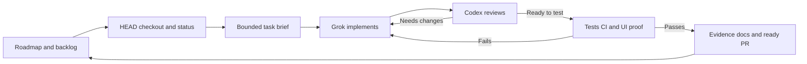

# Development workflow (Codex + Grok)

Date: 2026-11-07. This is the operating guide for how we build Sentinel Markets. It is not a live progress report and it does not add a new approval policy. Product status lives on the [V2 roadmap](../Sentinel_Markets_2_0_Roadmap.md) and [V2 backlog](V2_BACKLOG.md). Worked examples of evidence notes are [P3-A indicator verification](P3A_INDICATOR_VERIFICATION.md) and [P3-B watchlist UI verification](P3B_WATCHLIST_UI_VERIFICATION.md). Those notes record specific SHAs and CI runs; this page does not. A unit marked ready here is not a formal GitHub review, a merge, or a deploy.

## Roles

| Role | Owns | Does not own |
| --- | --- | --- |
| User / product owner | Product direction, priorities, and the right to stop or steer at any time | Relaying every prompt between agents |
| Codex / manager / reviewer | Scope, the task brief, branch and PR state, independent review, accept or reject | Treating Grok's self-report as acceptance |
| Grok / implementer | Code, tests, and docs for the briefed unit | Git, unless a brief explicitly says otherwise |

Codex reads the repository, `AGENTS.md`, and the skills that apply, then decides routine implementation details inside the authorization the user already gave. That authorization stays in force. Codex does not ask again for the same class of routine work. Codex asks only when a product, provider, spend, or access decision is actually required, and continues independent authorized work while waiting.

Grok writes the change. Codex then reads the connected code and the diff, checks the tests and other evidence, checks that the fix stayed in scope, and accepts or rejects. A Grok summary is a handoff, not acceptance and not a formal GitHub approval. Codex owns checkout, commits, push, and PR status. Grok normally does not run git.

## Loop



1. Pick the next unit from the roadmap or backlog.
2. Check HEAD, checkout, and status, including untracked files. The same SHA is not the same working tree. An empty `git diff` does not include untracked files.
3. Write a bounded brief: exact files, acceptance criteria, invariants, environment, and what is out of scope.
4. Grok implements. Existing-file edits that are small use a surgical edit, not a whole-file rewrite. Leave unrelated user changes and credentials alone.
5. Codex reviews. Feedback names severity, concrete impact, the file evidence, what the fix must do, and how it will be verified. "All good" is not a review.
6. Run the tests, CI, and browser proof that match the risk. Record evidence and update the docs the brief required.
7. Mark the PR ready only after those checks. Then take the next unit.

Units use isolated branches and stacked pull requests, which is current practice. Independent units with non-overlapping files may run in parallel. Two writers never edit the same files.

## Working tree

Before writing, record the branch, the HEAD SHA, and `git status`, including untracked files. Two checkouts can have the same HEAD and different uncommitted files. Review the tree you will commit, not only the SHA you checked out. `git diff` and `git diff --cached` omit untracked files, so an empty diff can still hide a new test, a secret, or a local note. Codex stages only the owned files from the brief.

If the user has unrelated edits in the tree, leave them. Do not revert, reformat, or fold them into the unit to make the diff look clean. Do not open, copy, or print `.env` files, dumps, tokens, or positions while you inspect that status.

## Task brief

Copy this. Keep it short. It is a brief, not an implementation manual.

```text
Objective:
Baseline and dependencies:
Owned files:
Required behavior and invariants:
Out of scope:
Tests and evidence:
Stop or handoff when:
```

State the baseline commit the work starts from. Name every file the implementer may change. Say which calculations, grants, or UI states must stay true. Say what a passing run must show, including allowed skips. Say when to stop: scope breach, a real platform block, missing product input, or the acceptance criteria met.

## When the same task stalls twice

The first attempt stays narrow. The follow-up must be intelligible: what failed, where, and what changed. After two concrete failed or stalled attempts on the same task, Codex may take over that unit under the user's standing permission, say why the fallback is happening, and still pass the same review and tests. Count repeated failure to carry out the scoped fix after clear feedback. Ordinary failed tests during productive iteration do not by themselves count as a stalled task.

A real blocker is an authentication, permission, billing, or platform restriction. Do not bypass policy or turn off a guard to look finished. On this Windows workstation, Application Control blocks Selenium. Use the Linux headless browser job in CI. Do not rename or wrap the blocked executable to slip past that control. If the task is already complete when a CLI session hits its turn cap, do not rewrite it. Inspect the files.

## Verification matches the risk

- Math and validators need a meaningful unit test or an independent reference calculation.
- Locking, migrations, grants, and concurrency need an actual isolated disposable PostgreSQL proof. A script that grants to the app role can change that role for the whole cluster. A fresh database on a shared server is not isolation.
- A UI change needs browser proof of the rendered flow, with desktop and mobile screenshots. Cover signed-out, signed-in, and owner isolation when those states apply. An AST check, a successful JavaScript compile, or "the frontend was not changed" is not live browser proof.
- Use designated test accounts. Automated acceptance-harness mutations run only in an explicit disposable environment. A separately authorized hosted journey names the environment, the designated account, and the action boundaries. Never point the disposable harness at the shared host. A hosted read-only check may use authorized operator authentication. It does not use a public admin endpoint. Do not print secrets, tokens, or positions.
- A restore proof must follow the application's recovery path and check schema, data, sequences, and ledger reconciliation. Listing snapshots is not a restore.

Secret and dependency scans stay on. If a scanner flags a fake token in a test, change the test literal. Do not bypass the scanner. On failure, say whether it is an application bug, a test-fixture bug, or an environmental blocker, and fix the root cause. Do not weaken the check. Keep money, auth, ledger, and execution invariants inside the declared scope. Missing, unavailable, or null data stays missing. Do not invent `0`, history, or a coverage claim.

## Evidence, ready, and release

Record the exact baseline SHA, the accepted code SHA, the CI run, test skips, screenshot review, and the docs updated. A green run on an older HEAD does not prove a later HEAD. Required CI must be green on the final PR head. In this repository the push workflow includes a documentation-only head, so that head needs its own green run too.

Ready means the checks for that unit passed. It does not mean formal review approval, merge, or deploy. Accepting a unit does not complete a phase and does not release the product. Release is a separate authorized scope. It needs the relevant migration, grants, backup, and rollback notes, plus acceptance in the actual environment. A worker finishing a unit does not change production.

## Status, stop, and the next unit

During active work, update about once a minute. Say the verified result, the current issue, and the next step or the help needed. After a unit is verified, continue to the next unit until the user stops or interrupts, until a real credit limit is hit, or until the next step depends on input only the user can give. A status question or a clarification steers the work. It does not cancel it.

Honor stop or pause promptly. The handoff note records:

- branch, HEAD SHA, and whether the working tree is clean
- files finished, files still open, and anything left untracked on purpose
- tests and CI already run, with run IDs, skips, and what was not run
- the next action, remaining blockers, and controlled worker IDs

Do not put credentials in that note. Another agent should be able to resume from it without replaying the chat.
