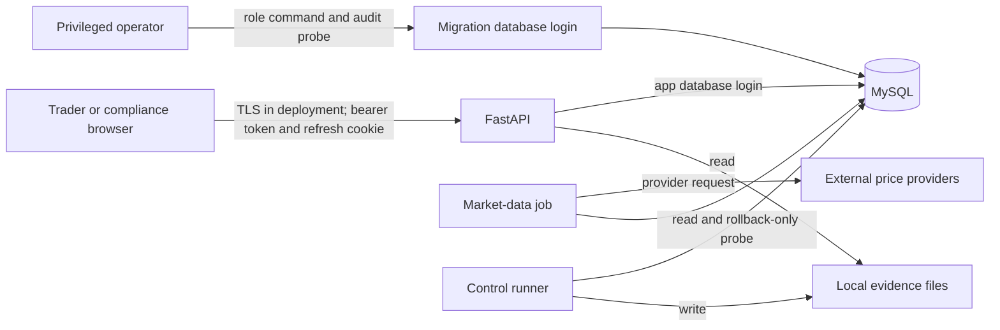

# Sentinel Markets threat model

Updated: 2026-10-29. Scope: the local FastAPI application, React client, MySQL database, market-data jobs, privileged role-change command, and control evidence on disk. This is a mock brokerage; the threat model does not imply a production security certification.

## Assets and trust boundaries

Assets: account credentials and refresh tokens; cash, holdings, orders, trades, and ledger postings; role approvals and access reviews; provider API keys; control results and evidence files.

The browser/API boundary is untrusted input. The API/database boundary is protected by a restricted app login, while the migration login can change schema and role-audit triggers. Provider responses are untrusted data. Local evidence files and the machine running jobs share an operator trust boundary; filesystem access can modify or remove evidence.

## STRIDE review

| Threat | Entry or asset | Current safeguard | Remaining exposure and next action |
| --- | --- | --- | --- |
| Spoofing | Login, access and refresh tokens | Password hashing, login rate limit and account backoff; signed access tokens; hashed rotating refresh tokens | No MFA or device binding. Add MFA and session revocation before production use. |
| Tampering | Orders, balances, ledger | Idempotency keys, row locking, reservations, balanced hash-chained ledger, app role without ledger update/delete, MySQL ledger triggers; SM-LD-01 reconciliation | Migration login or filesystem operator can bypass or erase evidence. Restrict and independently monitor privileged credentials; archive evidence outside the app host. |
| Repudiation | Role changes and control runs | Approval request, separate compliance approval, `users.role` audit trigger, SM-AC-01/02 checks, timestamped evidence with SHA-256 output | Evidence files are writable and role trigger can be changed by migration login. Independent storage and reviewer signoff remain open. |
| Information disclosure | User data, provider key, tokens | Ignored `.env`, scoped account endpoints, role-gated compliance routes, HttpOnly refresh cookie | Local development can use an insecure refresh cookie; no field encryption, MFA, or complete log-redaction review. Require TLS and secure cookie in deployment; review logs and backups. |
| Denial of service | Login, registration, market data, order entry | Login and registration limits, supported symbol validation, cached market data, order checks | In-process rate-limit state and provider availability are single points of failure. Move limits to shared storage and define provider failover for multi-instance deployment. |
| Elevation of privilege | App roles and migration login | Trader role default; app login cannot update `users.role`; request/approval/operator workflow; direct role changes create audit rows | The privileged database login can alter trigger or grants. Separate deployment and app credentials, monitor database administrative actions, and review access quarterly. |

## Priority and review triggers

1. The owner confirmed revocation of the previously exposed Alpha Vantage key. Retain the provider confirmation with the incident record.
2. Add independent storage for control evidence and monitoring of the migration login before claiming tamper-resistant audit evidence.
3. Add CI security gates, deployment grant verification, and a repeatable reconciliation schedule.
4. Revisit this model when changing authentication, database engine, hosting, market-data providers, or the order/ledger write paths. Record owner review and date here before calling it approved.

Owner review: pending.
