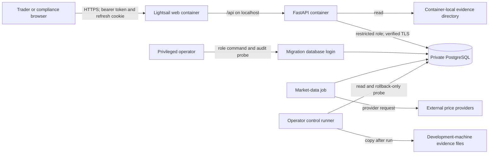

# Sentinel Markets threat model

Updated: 2026-10-31. Scope: the public AWS Lightsail recruiter demo, its React and FastAPI containers, private PostgreSQL 17 database with migrated local data, manual market-data and control jobs, privileged role-change command, and control evidence on the development machine. This is a mock brokerage; the threat model does not imply a production security certification.

## Assets and trust boundaries

Assets: account credentials and refresh tokens; cash, holdings, orders, trades, and ledger postings; role approvals and access reviews; provider API keys; control results and evidence files.

The browser/web boundary is untrusted input. Only the web container is public; it proxies to the API. The API/database boundary uses a restricted app login and verified TLS, while the migration login can change schema and role-audit triggers. Provider responses are untrusted data. The hosted control run wrote evidence to a temporary operator host, then it was copied to ignored local `grc/evidence/`. The API's separate evidence directory remains empty, so the live console shows `not_run`. The copied evidence remains editable by the machine operator and needs independent retention.

## STRIDE review

| Threat | Entry or asset | Current safeguard | Remaining exposure and next action |
| --- | --- | --- | --- |
| Spoofing | Login, access and refresh tokens | Password hashing, login rate limit and account backoff; signed access tokens; hashed rotating refresh tokens | No MFA or device binding. Add MFA and session revocation before production use. |
| Tampering | Orders, balances, ledger | Idempotency keys, row locking, reservations, balanced hash-chained ledger, app role without ledger update/delete, PostgreSQL ledger triggers; SM-LD-01 reconciliation | Migration login or filesystem operator can bypass or erase evidence. Restrict and independently monitor privileged credentials; archive evidence outside the app host. |
| Repudiation | Role changes and control runs | Approval request, separate compliance approval, `users.role` audit trigger, SM-AC-01/02 checks, timestamped evidence with SHA-256 output | Evidence files are writable and role trigger can be changed by migration login. Independent storage and reviewer signoff remain open. |
| Information disclosure | Migrated user data, provider key, tokens | Private database, verified database TLS, scoped account endpoints, role-gated compliance routes, HTTPS and secure HttpOnly refresh cookie in AWS | Local development can use an insecure refresh cookie. Lightsail deployment environment values are visible to project administrators; no field encryption, MFA, or complete log-redaction review. Limit project access and review logs and backups. |
| Denial of service | Login, registration, market data, order entry | Login and registration limits, supported symbol validation, cached market data, order checks | In-process rate-limit state and provider availability are single points of failure. Move limits to shared storage and define provider failover for multi-instance deployment. |
| Elevation of privilege | App roles and migration login | Trader role default; app login cannot update `users.role`; request/approval/operator workflow; direct role changes create audit rows | The privileged database login can alter trigger or grants. Separate deployment and app credentials, monitor database administrative actions, and review access quarterly. |

## Priority and review triggers

1. The owner confirmed revocation of the previously exposed Alpha Vantage key. Retain the provider confirmation with the incident record.
2. Add independent storage for control evidence and monitoring of the migration login before claiming tamper-resistant audit evidence.
3. Hosted app-role grants and a manual reconciliation passed. Add repeatable hosted reconciliation and market-data refresh schedules. CI security gates are operating on the draft PR.
4. Revisit this model when changing authentication, database engine, hosting, market-data providers, or the order/ledger write paths. Record owner review and date here before calling it approved.

Owner review: pending.
