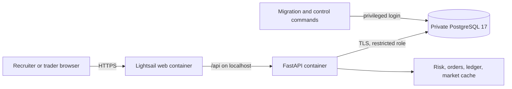

# Sentinel Markets

**A mock brokerage where trades, risks, and role changes leave an audit trail.**

Sentinel Markets is a mock brokerage built to show how trading systems and governance controls fit together. It uses paper cash and simulated orders; it does not connect to a brokerage or move real money. The project is a recruiter-facing demonstration, not a regulated production service.

**[Open the live demo](https://fintechapp-preview.gps5zt7wg4yqg.us-east-2.cs.amazonlightsail.com/)** | [Control matrix](grc/control_matrix.csv) | [GRC roadmap](Finance%20Project%20Roadmap%20Built%20for%20GRC.md) | [Current action items](docs/GRC_ACTION_ITEMS.md)

## What the demo shows

- **Paper trading:** New trader accounts start with $100,000 in simulated cash. Users can enter limit and market orders, inspect the order book, cancel open orders, and view holdings, lots, realized P&L, and risk alerts. The matching engine uses price-time priority and reserves cash or shares for open orders.
- **Pre-trade controls:** Buying-power and available-share checks, a 20% reference-price band, a 50% per-symbol concentration limit, a $50,000 stock-position limit, idempotency keys, and an audited trading halt.
- **Explainable accounting:** Trades create balanced, hash-chained ledger postings. PostgreSQL triggers reject ledger updates and deletes; a reconciliation command checks cash and positions against the ledger.
- **Governance workflow:** Trader, admin, compliance-officer, and auditor roles; separate request, approval, and privileged application of role changes; quarterly access-review records; a risk register linked to controls; and a compliance console that displays control status.
- **Market research:** A Nasdaq symbol universe, cached quotes and daily price history, sector heatmap, and SEC company fundamentals. Quotes display their freshness state. Alpha Vantage is optional for research; the public market view uses cached data.

The live site has the existing PostgreSQL data copied from local development. Privileged account credentials are intentionally not published. Recruiters can register a trader account to explore the paper-trading flow.

## Current implementation

| Area | Status |
| --- | --- |
| Web and API | React/Vite frontend and FastAPI backend live on an AWS Lightsail HTTPS address in the selected Region `us-east-2`; no custom domain is needed. |
| Database | Private Lightsail PostgreSQL 17, Alembic revision `c7e8f1a2b345`, with a restricted application role and separate migration login. The 2026-10-31 cutover matched 15,164 rows across 21 application tables and 17 sequences. |
| Recovery | Seven days of Lightsail automatic database backups and a retained post-migration manual snapshot. |
| Controls | A 2026-10-31 operator run against AWS passed app-role grants, role-change audit, ledger reconciliation, and market-data freshness. Trading-halt, open-order price-band, and idempotency operating checks had no live sample. |
| CI | Six required jobs: backend tests, frontend lint/tests/build, Gitleaks, Bandit and pip-audit, Semgrep, and Trivy. |

Market quotes were refreshed once after the cutover. Automatic hosted quote refresh and ledger reconciliation are still open, so freshness will decline until those jobs are scheduled. The live compliance console currently shows 11 controls as `not_run`: the operator's passing evidence is stored outside the API container and is not yet mounted or imported there. MFA, independent evidence storage and review, and a completed access review are also open. See the [action-item ledger](docs/GRC_ACTION_ITEMS.md) before presenting this as a production control environment.

## Architecture



The web container runs Nginx on port 8080 and serves the single-page app. It proxies `/api/` to FastAPI on port 8000 in the same Lightsail container service. Only the web container has a public endpoint. The API health check performs a database query. See [Architecture](Architecture.md), the [threat model](docs/THREAT_MODEL.md), and the [AWS operations runbook](docs/aws_deployment.md).

## Run locally

Requirements: Docker, Node.js 22, and npm. From the repository root, copy `.env.compose.example` to ignored `.env.compose` and replace its three placeholders with distinct random values. Then start a clean PostgreSQL 17 database and API:

```powershell
docker compose --env-file .env.compose up --build -d
```

In another terminal, start the frontend:

```powershell
cd frontend
npm ci
npm run dev
```

Open <http://127.0.0.1:5173>. The local API is at <http://127.0.0.1:8000>, with development docs at `/docs`. Compose creates its own database volume; it does not use the migrated local database or the AWS database. To stop without deleting its volumes, run `docker compose --env-file .env.compose down`. For a non-Compose setup or a data migration, follow [PostgreSQL migration](docs/postgresql_migration.md). Never commit `.env` files, database dumps, or account credentials.

## Verify changes

```powershell
python -m pip install -r requirements.txt -r requirements-dev.txt
python -m pytest -q
cd frontend
npm ci
npm run lint
npm test
npm run build
```

From the repository root, `python -m app.scripts.run_controls` checks seven application controls when `DATABASE_URL`, `MIGRATION_DATABASE_URL`, and `JWT_SECRET` are configured. It writes evidence under ignored `grc/evidence/`; a `no_sample` result is not proof of operating effectiveness. CI also runs security scanners and uploads an API CycloneDX SBOM. The [security summary](Security.md), [control workpapers](grc/workpapers), and [policies](grc/policies) explain the safeguards and their limits.

## Repository map

| Path | Purpose |
| --- | --- |
| `app/`, `alembic/`, `tests/` | FastAPI routes, services, migrations, and backend tests. |
| `frontend/` | React/Vite client, API modules, and frontend tests. |
| `grc/controls/`, `grc/workpapers/`, `grc/policies/` | Control definitions, test workpapers, and draft policies. |
| `docs/postgresql_migration.md` | MySQL-to-PostgreSQL history and the verified AWS data cutover. |
| `docs/aws_deployment.md` | Live AWS resources, deployment procedure, recovery, costs, and remaining operations. |

Development continues on the [draft GRC roadmap PR](https://github.com/slowgold05/Fintech-trading-risk-engine/pull/1). The roadmap and policies are working documents; their approval and independent evidence review remain open.
