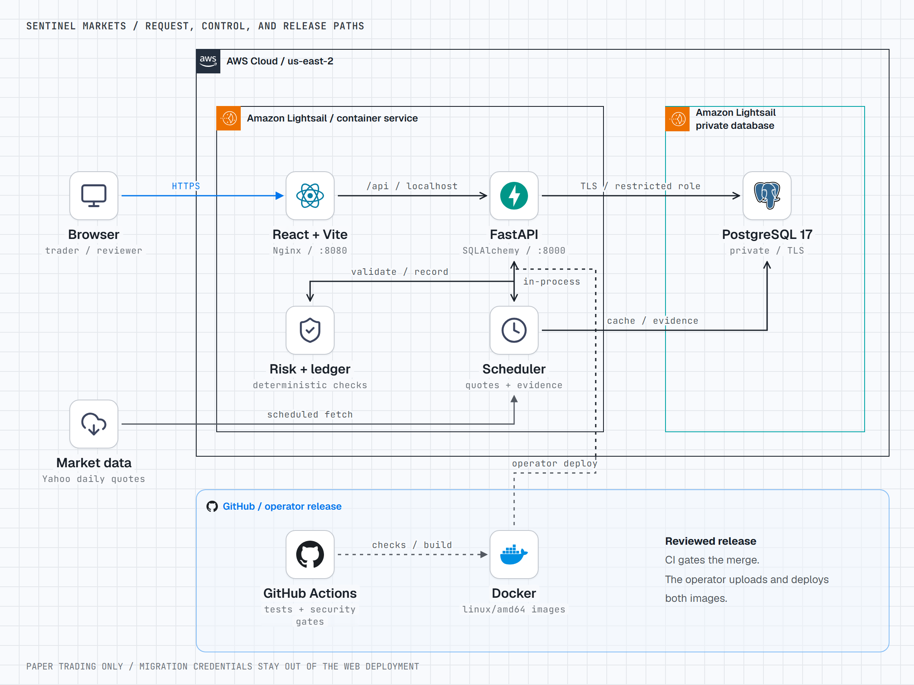

# Sentinel Markets

Sentinel Markets is a paper-trading brokerage where orders, cash movements, risk checks, and access decisions leave an audit trail. Follow a trade from its pre-trade checks through matching, holdings, realized P&L, and balanced ledger postings, then inspect the controls and evidence behind it.

The system keeps trading limits deterministic and review decisions explicit. Surveillance and AML rules require independent activation approval. Trade intents record proposals and human decisions; approving an intent does not place an order.

> Sentinel Markets is a demonstration using simulated cash and orders. It has no live broker connection, moves no real money, and does not establish regulatory compliance or production readiness.

**[Open the live demo](https://fintechapp-preview.gps5zt7wg4yqg.us-east-2.cs.amazonlightsail.com/)** · **[API health](https://fintechapp-preview.gps5zt7wg4yqg.us-east-2.cs.amazonlightsail.com/api/health)** · [Control matrix](grc/control_matrix.csv) · [Current action items](docs/GRC_ACTION_ITEMS.md)

---

## Explore the live demo

The application opens its public market dashboard at `/` or `/dashboard`, with a **Log in** button at the top right. Signing in opens the account dashboard; market research remains available at `/market`. Portfolio, trading, risk, and compliance pages require a session. [Register or sign in](https://fintechapp-preview.gps5zt7wg4yqg.us-east-2.cs.amazonlightsail.com/login) to explore a trader account with **$100,000 in paper cash**. Admin and compliance-officer credentials are not published. This entry-flow update requires a frontend deployment after the release recorded below.

| Area | What to explore |
| --- | --- |
| Dashboard | Account summary, positions, recent activity, and risk indicators. |
| Trades | Cached stock prices, market and limit orders, the order book, and cancellation. |
| Portfolio | Holdings, cost basis, realized P&L, paper deposits, and withdrawals. |
| Risk | Rule-based assessments and alerts associated with executed trades. |
| Compliance | Role-gated controls, evidence, access reviews, surveillance, AML, incidents, and proposal decisions. |

Trader accounts cannot enter the compliance console. An auditor can read compliance records; mutation rights are restricted to the appropriate review roles. Authenticator enrollment is available, and a high-risk login can require enrollment even while broad MFA enforcement is off.

The hosted release and its verification results are documented below. The two-minute walkthrough is still to be recorded; [the video shot list](docs/VIDEO_SCRIPT.md) describes the planned demo.

## What it does

| Capability | What Sentinel Markets does | Why it matters |
| --- | --- | --- |
| Paper trading | Matches eligible orders by price and time, supports partial fills, and reserves cash or shares for open orders | Makes buying power and order state inspectable |
| Pre-trade controls | Enforces available cash and shares, a 20% reference-price band, a 50% per-symbol concentration cap, a $50,000 stock-position cap, and an audited halt | Applies explicit limits before execution |
| Trade accounting | Records holdings, lots, realized P&L, and balanced, hash-chained ledger postings | Lets reconciliation check balances and positions against recorded events |
| Cash movements | Locks balances and commits each movement, ledger posting, and idempotency response together | Prevents concurrent withdrawals from spending the same cash and retries from posting twice |
| Identity and access | Provides five roles, password authentication, optional authenticator enrollment, login-risk step-up, and current-code checks for large transactions | Separates trading, review, audit, and privileged operations |
| Role governance | Requires a request, independent approval, and privileged application of role changes; records quarterly access reviews | Preserves who requested, approved, and applied access changes |
| Trade surveillance | Implements four versioned detection rules, labeled backtests, activation requests, case dispositions, and deadlines | Connects a detection to its rule version, activity, and review history |
| AML and sanctions | Implements two cash-monitoring rules and onboarding/payout screening, with repeat-scan and replay protection | Demonstrates cash-control workflows while clearly identifying fixture-backed screening |
| Control evidence | Defines 28 controls and 29 risks, stores operating results, and exports evidence with a SHA-256 manifest | Keeps passes, failures, missing samples, and unrun controls distinguishable |
| Incidents and SAR drafts | Tracks incident deadlines and produces verified template narratives from case event IDs | Keeps evidence traceable and filing decisions outside the drafting component |
| Research and proposals | Provides a Nasdaq universe, quote cache, sector heatmap, SEC fundamentals, and structured trade intents | Supports research and review without giving proposals authority to trade |

The four surveillance rules cover wash trading, spoofing/layering, pump-and-dump, and unusual volume. The two AML rules cover structuring and rapid movement. **All remain inactive on the hosted service until separately approved.** With `YENTE_URL` empty, sanctions screening uses a local test fixture, not an OFAC or OpenSanctions list.

## End-to-end workflow

1. A user registers a trader account and signs in; enrolled accounts complete an authenticator challenge.
2. The trader inspects cached quotes and their freshness, then submits an order with an idempotency key.
3. Deterministic checks evaluate trading status, reference prices, buying power or available shares, and applicable position limits.
4. The order book reserves resources and matches eligible opposite orders by price-time priority. Unmatched limit orders can remain open; unfilled market-order remainders are canceled.
5. Fills update cash, holdings, lots, risk assessments, and balanced ledger postings within the transaction.
6. Paper deposits and withdrawals use a separate locked cash workflow. New withdrawals need a legal name, a clear screen, and available cash after reservations.
7. The scheduler refreshes quotes, runs application controls, stores evidence, and scans activity using approved rule versions.
8. Reviewers inspect cases and proposals, record decisions, and manage access-review or incident work. Auditors can export the latest evidence and verify its hashes.

## Rules, models, and human review

The implemented proposal and forecasting components have deliberately limited authority:

- Trade intents validate structured fields and reject malformed, oversized, or injection-flagged proposals. Approval records the reviewer and time without creating an order.
- The current forecast is a historical-volatility baseline with seeded simulations and a monitor. Kronos weights are not loaded, and the forecast does not change a hard order limit.
- Technical, risk, and debate notes are deterministic. Risk briefs and SAR narratives use templates; no external language model was called for the deployed build.
- Model cards and validation reports record fixture results and limitations. Small labeled scenario sets are not production-performance evidence.
- Surveillance and AML activation require a second reviewer and a matching rule version. Per-detector locks serialize scans; full event identities distinguish reviewed activity from new qualifying patterns.

Policies, models, vendor notes, and the asset inventory still require their respective owners' approval. Implementation does not imply approval. See the [model inventory](grc/models/inventory.yaml), [model-risk policy](grc/policies/model_risk.md), and [expansion roadmap](docs/Sentinel%20Markets%20%E2%80%94%20Expansion%20Roadmap.md).

## Architecture

<picture>
  <source media="(prefers-color-scheme: dark)" srcset="docs/diagrams/sentinel-markets-stack-dark.png">
  <source media="(prefers-color-scheme: light)" srcset="docs/diagrams/sentinel-markets-stack.png">
  
</picture>

[Light PNG](docs/diagrams/sentinel-markets-stack.png) · [Dark PNG](docs/diagrams/sentinel-markets-stack-dark.png) · [Self-contained HTML](docs/diagrams/sentinel-markets-stack.html) · [Diagram sources and notices](docs/diagrams/NOTICE.md)

The web and API containers share one Amazon Lightsail container service in **`us-east-2`**. Nginx serves the React app on port 8080 and proxies `/api/` to FastAPI on localhost port 8000. Only the web container has a public endpoint. The API connects to private PostgreSQL over verified TLS using a restricted database role.

The scheduler runs inside the API process, coordinated through a database lease and persisted next-due time. GitHub CI gates merges; an operator builds and uploads Docker images and creates the deployment. Schema changes use a separate temporary private runner. The migration credential is kept out of the web deployment, and the runner is deleted afterward. The diagram shows Lightsail-managed boundaries and does not infer a customer-managed VPC or subnets.

| Layer | Technology | Responsibility |
| --- | --- | --- |
| Web | React 19, TypeScript, Vite, Tailwind CSS, TanStack Query | Trader views, research, review workflows, and API state |
| HTTP serving | Nginx | Static frontend, deep links, and same-origin API proxy |
| API | Python 3.12, FastAPI, Pydantic, SQLAlchemy | Validation, authorization, matching, cash, risk, and compliance services |
| Data | PostgreSQL 17, Alembic | Transactions, lots, ledger, approvals, control evidence, and scan/scheduler state |
| Identity | PyJWT, bcrypt, time-based authenticator codes | Sessions, password verification, login-risk checks, and step-up |
| Market inputs | Yahoo daily quotes, Nasdaq symbol data, SEC fundamentals | Cached market research with freshness information |
| Infrastructure | Docker, Docker Compose, Amazon Lightsail | Isolated local development and the hosted web/API/private-database deployment |
| CI | GitHub Actions, Gitleaks, Bandit, pip-audit, Semgrep, Trivy | Required tests, frontend checks, security scanning, and API SBOM output |

See [the architecture notes](Architecture.md), [threat model](docs/THREAT_MODEL.md), and [AWS operations runbook](docs/aws_deployment.md) for the detailed flows and recovery procedure.

## Security and control boundaries

- The runtime database login cannot update `users.role` or change existing ledger and control-evidence rows. A separate privileged login handles migrations and approved role changes.
- PostgreSQL triggers audit privileged role updates and reject ledger mutation. Reconciliation checks ledger hashes, balanced events, cash, and positions.
- Deposits and withdrawals reload a locked user row. Authenticator-code consumption and login challenges use a consistent lock order and conditional writes.
- A failed AML pass does not reverse or hide an already committed cash movement; detection remains pending for retry.
- Configured sanctions-provider errors fail closed. Successful withdrawal replays return their stored result before screening again.
- The hosted app uses HTTPS, secure refresh cookies, HSTS, and disabled API documentation. The API health endpoint queries the database.
- Credentials, generated account passwords, and exported operating evidence stay out of git. Normal application credentials remain hosting environment values readable by project administrators; a separate secret manager remains open.

The [security summary](Security.md), [security audit](docs/security/AUDIT-001.md), [control workpapers](grc/workpapers), and [policies](grc/policies) describe the implemented safeguards and their limits. Reporting instructions are in [docs/SECURITY.md](docs/SECURITY.md).

## Tests and measurable checks

The **2026-11-04 application release** was verified with:

- **134 passing backend tests**, including migration, restricted-role, cash, MFA, and detector concurrency proofs against fresh disposable PostgreSQL 17; no skips in that run.
- **9 passing frontend tests**, plus ESLint, TypeScript checks, and the production build.
- **Six passing required CI jobs**, including secret, static-analysis, dependency, and container-image scans.
- Live HTTP checks for operator login, compliance endpoints, intent approval, paper cash replay, and order placement/replay/cancellation. The order test executed no fill.
- Ledger reconciliation for **14 accounts with zero failures** after smoke testing.
- A first scheduled cycle that refreshed **180 quotes**, stored **23 evidence payloads**, released its lease, and saved its next due time. Exported payload hashes verified.

The first hosted control snapshot contained **10 passes, 12 `no_sample`, one MFA-enrollment failure, and five `not_run` controls** outside the scheduled runner. These are dated operating results, not an assertion that every control passed. Browser click-through remains unverified because the browser automation service was unavailable during release verification.

```powershell
python -m pip install -r requirements.txt -r requirements-dev.txt
python -m pytest -q

Set-Location frontend
npm ci
npm run lint
npm test
npm run build
```

Set `AUDIT_DATABASE_URL` to a **fresh disposable PostgreSQL database** to run the PostgreSQL proofs; they otherwise skip. These tests create records and refresh a database role. Never point them at the hosted or development database.

The operator control runner checks 24 controls when its restricted and privileged database settings are configured; the hosted application cycle runs 23 without the migration login. Four additional controls are repository or design checks. A `no_sample` result does not establish operating effectiveness.

## Run locally

Prerequisites: Docker Desktop, Node.js 22, and npm. Copy the Compose example:

```powershell
Copy-Item .env.compose.example .env.compose
```

Replace the `POSTGRES_PASSWORD`, `POSTGRES_APP_PASSWORD`, and `JWT_SECRET` placeholders with distinct random values. Start the database and API:

```powershell
docker compose --env-file .env.compose up --build -d
```

Start the frontend in another terminal:

```powershell
Set-Location frontend
npm ci
npm run dev
```

Open **http://127.0.0.1:5173**. The API is at **http://127.0.0.1:8000**, with local development documentation at `/docs`.

Compose creates a separate development database volume; it does not connect to the hosted database or reuse the migrated local data. To stop the stack while retaining its data:

```powershell
docker compose --env-file .env.compose down
```

For a non-Compose setup and the migration history, see [PostgreSQL migration](docs/postgresql_migration.md). Never commit `.env` files, database dumps, or account credentials.

## Deployment

The hosted release runs on the AWS-provided Lightsail HTTPS address, with a private PostgreSQL 17 database and no custom domain. Deployment **7** uses API `:fintechapp-preview.api.3` and web `:fintechapp-preview.web.4`; the schema is **`f3a8c2d7e961`**. Application changes were merged in [PR #12](https://github.com/slowgold05/Fintech-trading-risk-engine/pull/12), with the operating record updated in [PR #13](https://github.com/slowgold05/Fintech-trading-risk-engine/pull/13).

`SCHEDULED_JOBS_ENABLED` is on. `MFA_REQUIRED` remains false, and `YENTE_URL` remains empty. The temporary migration runner was removed after grants and ledger verification. Automatic database backups and a retained recovery snapshot are available. The service has fixed capacity and does not autoscale.

Build, private migration, deployment, rollback, and cleanup instructions are in [docs/aws_deployment.md](docs/aws_deployment.md). Quote freshness depends on provider availability and refresh limits; the scheduler does not guarantee every symbol is current.

## Repository map

```text
app/                  FastAPI routes, models, services, and operator scripts
alembic/              Versioned database migrations
frontend/             React client, API modules, and frontend tests
tests/                Backend unit, integration, and PostgreSQL race proofs
grc/controls/         Control definitions and generated matrix inputs
grc/workpapers/       Design and operating-test workpapers
grc/policies/         Draft policies and review requirements
grc/models/           Model inventory, cards, and validation reports
docs/diagrams/        Self-contained architecture diagram and themed PNGs
docs/                 Architecture, release records, operations, and roadmaps
```

## Current limitations and remaining roadmap

- **Demonstration scope:** all money and trading are simulated. This is not a regulated brokerage, a compliance determination, or a production control environment.
- **Data quality:** the new quality checks still need enforcement on every price load and order. Persistent checksums, lineage, and actor/reason override records remain unfinished.
- **Live integrations:** expansion-provider adapters, historical backfills, the persisted news/social feed, and ticker buzz panel are incomplete. New signal accounts need verified onboarding and approval.
- **Proposal risk checks:** the intent path still needs the full pre-trade checks and a daily-loss limit. Forecast advice is not wired into order limits, and Kronos is not loaded.
- **Reporting:** scheduled risk briefs, authorized outbound alerts, and optional PDF/XLSX workpapers remain open. SAR narratives and briefs are templates.
- **Security and evidence:** secret management, independent evidence retention, provider proof of the exposed Alpha Vantage key's revocation, and safe MFA recovery/rotation remain open. Broad MFA enrollment is incomplete; the dedicated smoke account needs an access-review decision.
- **Human review:** policies, model cards, vendors, and inventory await owner approval. Surveillance and AML rules remain inactive; fixture precision/recall is not a production-performance claim.
- **Verification and presentation:** live browser click-through, the demo video, and the external GRC Sentinel connection remain open. Passkeys, crypto, and replay mode are deferred.

The [GRC roadmap](Finance%20Project%20Roadmap%20Built%20for%20GRC.md), [expansion roadmap](docs/Sentinel%20Markets%20%E2%80%94%20Expansion%20Roadmap.md), and [action-item ledger](docs/GRC_ACTION_ITEMS.md) track the remaining work. Historical implementation details are in the [expansion build notes](docs/EXPANSION_CHANGES.md) and the linked phase records. [Development workflow (Codex + Grok)](docs/GROK_CODEX_WORKFLOW.md) is how we scope, implement, and review that work.
