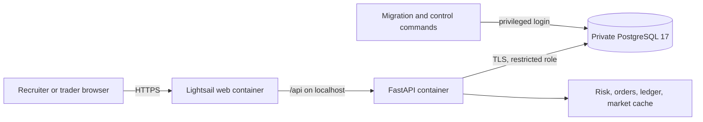

# Sentinel Markets

**A mock brokerage where trades, risks, and role changes leave an audit trail.**

Sentinel Markets is a mock brokerage built to show how trading systems and governance controls fit together. It uses paper cash and simulated orders; it does not connect to a brokerage or move real money. It is a demonstration for anyone who wants to explore how financial controls work in a trading system, not a regulated production service.

**[Open the live demo](https://fintechapp-preview.gps5zt7wg4yqg.us-east-2.cs.amazonlightsail.com/)** | [Control matrix](grc/control_matrix.csv) | [Video shot list](docs/VIDEO_SCRIPT.md) | [GRC roadmap](Finance%20Project%20Roadmap%20Built%20for%20GRC.md) | [Current action items](docs/GRC_ACTION_ITEMS.md)

The two-minute walkthrough has not been recorded. `docs/VIDEO_SCRIPT.md` is the shot list. There is no GIF. The live demo is the previous image. Phase 5 and Phase 6 exist in this working tree.

## What the demo shows

- **Paper trading:** New trader accounts start with $100,000 in simulated cash. Users can enter limit and market orders, inspect the order book, cancel open orders, and view holdings, lots, realized P&L, and risk alerts. The matching engine uses price-time priority and reserves cash or shares for open orders.
- **Pre-trade controls:** Buying-power and available-share checks, a 20% reference-price band, a 50% per-symbol concentration limit, a $50,000 stock-position limit, idempotency keys, and an audited trading halt.
- **Explainable accounting:** Trades create balanced, hash-chained ledger postings. PostgreSQL triggers reject ledger updates and deletes; a reconciliation command checks cash and positions against the ledger.
- **Governance workflow:** Trader, admin, compliance-officer, and auditor roles; separate request, approval, and privileged application of role changes; quarterly access-review records; a risk register linked to controls; and a compliance console that displays control status.
- **Market research:** A Nasdaq symbol universe, cached quotes and daily price history, sector heatmap, and SEC company fundamentals. Quotes display their freshness state. Alpha Vantage is optional for research; the public market view uses cached data.

The live site has the existing PostgreSQL data copied from local development. Privileged account credentials are intentionally not published. Anyone who wants to explore can register a trader account and try the paper-trading flow.

## Current implementation

| Area | Status |
| --- | --- |
| Web and API | React/Vite frontend and FastAPI backend live on an AWS Lightsail HTTPS address in the selected Region `us-east-2`; no custom domain is needed. |
| Database | Private Lightsail PostgreSQL 17, Alembic revision `c7e8f1a2b345`, with a restricted application role and separate migration login. The 2026-10-31 cutover matched 15,164 rows across 21 application tables and 17 sequences. |
| Recovery | Seven days of Lightsail automatic database backups and a retained post-migration manual snapshot. |
| Controls | Twenty-eight controls and twenty-nine risks are defined in this working tree. The hosted database is still at Alembic `c7e8f1a2b345`. Migrations `1c4e8a7b2d90`, `a8d3c1e4b672`, `b7e2a9c4d815`, `c4d8e1a7b936`, `d5e9f2b8c047`, `e7b2c5d9a174`, and `f3a8c2d7e961` are not applied there. The live console still shows `not_run`. The live site does not run the expansion intents, findings, or risk brief. |
| CI | Six required jobs: backend tests, frontend lint/tests/build, Gitleaks, Bandit and pip-audit, Semgrep, and Trivy. |

Market quotes were refreshed once after the cutover. The API can now refresh hot and daily quotes, reconcile the ledger, and write control evidence on a schedule when `SCHEDULED_JOBS_ENABLED=true`. That flag is for the hosted service. The running Lightsail image does not include it yet, so freshness will decline until the new image is deployed. Evidence rows are append-only in PostgreSQL. A copy outside the database is still open. The Q4 2026 access review was recorded on the live API on 2026-11-03. Authenticator enrollment exists in this working tree and is not on the running image. `MFA_REQUIRED` stays false. See the [action-item ledger](docs/GRC_ACTION_ITEMS.md) before presenting this as a production control environment.

## Future roadmap

The code for the Phase 2 operating loop is in place: database evidence, scheduled refresh and reconciliation, and checks for access-review completeness, evidence immutability, and buying-power reservations. Phase 3 adds versioned surveillance rules, a labeled backtest, case SLAs, and second-approver activation. Those rules are not active, and the model-risk policy is still a draft. Phase 4 adds authenticator enrollment, login-risk step-up, and a current code on a large order. Passkey signing is not implemented. The access-control policy and the asset inventory are still drafts. The hosted service has not received this image. A later deploy would run migrations `1c4e8a7b2d90`, `a8d3c1e4b672`, `b7e2a9c4d815`, `c4d8e1a7b936`, `d5e9f2b8c047`, `e7b2c5d9a174`, and `f3a8c2d7e961`, reapply the app-role grants, and set `SCHEDULED_JOBS_ENABLED=true`. Leave `MFA_REQUIRED` false until every hosted account has enrolled. Leave `YENTE_URL` empty. The [full GRC roadmap](Finance%20Project%20Roadmap%20Built%20for%20GRC.md), the [expansion roadmap](docs/Sentinel%20Markets%20%E2%80%94%20Expansion%20Roadmap.md), and [action-item ledger](docs/GRC_ACTION_ITEMS.md) track progress. The change notes are [Phase 2](docs/PHASE2_CHANGES.md), [Phase 3](docs/PHASE3_CHANGES.md), [Phase 4](docs/PHASE4_CHANGES.md), [Phase 5](docs/PHASE5_CHANGES.md), [Phase 6](docs/PHASE6_CHANGES.md), and the [expansion](docs/EXPANSION_CHANGES.md).

## Architecture



The web container runs Nginx on port 8080 and serves the single-page app. It proxies `/api/` to FastAPI on port 8000 in the same Lightsail container service. Only the web container has a public endpoint. The API health check performs a database query. See [Architecture](Architecture.md), the [threat model](docs/THREAT_MODEL.md), and the [AWS operations runbook](docs/aws_deployment.md).

## Run locally

Requirements: Docker, Node.js 22, and npm. From the repository root, copy `.env.compose.example` to ignored `.env.compose` and replace its three placeholders with distinct random values. Then start a clean PostgreSQL 17 database and API:

```powershell
docker compose --env-file .env.compose up --build -d
```

In another terminal, start the frontend:

```powershell
cd frontend
npm ci
npm run dev
```

Open <http://127.0.0.1:5173>. The local API is at <http://127.0.0.1:8000>, with development docs at `/docs`. Compose creates its own database volume; it does not use the migrated local database or the AWS database. To stop without deleting its volumes, run `docker compose --env-file .env.compose down`. For a non-Compose setup or a data migration, follow [PostgreSQL migration](docs/postgresql_migration.md). Never commit `.env` files, database dumps, or account credentials.

## Verify changes

```powershell
python -m pip install -r requirements.txt -r requirements-dev.txt
python -m pytest -q
cd frontend
npm ci
npm run lint
npm test
npm run build
```

From the repository root, `python -m app.scripts.run_controls` checks twenty-four controls when `DATABASE_URL`, `MIGRATION_DATABASE_URL`, and `JWT_SECRET` are configured. That count includes SM-AC-02, which uses the migration login. Four more controls are repository or design checks and are not in that runner. The exported matrix has twenty-eight controls. SM-AM-01 reads `grc/asset_inventory.yaml`. The runner writes evidence under ignored `grc/evidence/`; a `no_sample` result is not proof of operating effectiveness. CI also runs security scanners and uploads an API CycloneDX SBOM. The [security summary](Security.md), [control workpapers](grc/workpapers), and [policies](grc/policies) explain the safeguards and their limits. Phase 5, Phase 6, and the expansion are written up in [docs/PHASE5_CHANGES.md](docs/PHASE5_CHANGES.md), [docs/PHASE6_CHANGES.md](docs/PHASE6_CHANGES.md), and [docs/EXPANSION_CHANGES.md](docs/EXPANSION_CHANGES.md). The hosted image does not run that expansion code.

## Repository map

| Path | Purpose |
| --- | --- |
| `app/`, `alembic/`, `tests/` | FastAPI routes, services, migrations, and backend tests. |
| `frontend/` | React/Vite client, API modules, and frontend tests. |
| `grc/controls/`, `grc/workpapers/`, `grc/policies/` | Control definitions, test workpapers, and draft policies. |
| `docs/postgresql_migration.md` | MySQL-to-PostgreSQL history and the verified AWS data cutover. |
| `docs/aws_deployment.md` | Live AWS resources, deployment procedure, recovery, costs, and remaining operations. |

Development continues on the [draft GRC roadmap PR](https://github.com/slowgold05/Fintech-trading-risk-engine/pull/1). The roadmap and policies are working documents; their approval and independent evidence review remain open.
