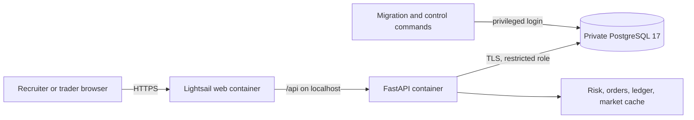

# Sentinel Markets

**A mock brokerage where trades, risks, and role changes leave an audit trail.**

Sentinel Markets is a mock brokerage built to show how trading systems and governance controls fit together. It uses paper cash and simulated orders; it does not connect to a brokerage or move real money. It is a demonstration for anyone who wants to explore how financial controls work in a trading system, not a regulated production service.

**[Open the live demo](https://fintechapp-preview.gps5zt7wg4yqg.us-east-2.cs.amazonlightsail.com/)** | [Control matrix](grc/control_matrix.csv) | [Video shot list](docs/VIDEO_SCRIPT.md) | [GRC roadmap](Finance%20Project%20Roadmap%20Built%20for%20GRC.md) | [Current action items](docs/GRC_ACTION_ITEMS.md)

The 2026-11-04 release adds surveillance, authenticator enrollment, paper cash movements, AML cases, incidents, stored control evidence, and propose-only trade intents to the hosted demo. The two-minute walkthrough has not been recorded; `docs/VIDEO_SCRIPT.md` is the shot list. The expansion roadmap remains partly complete, with live feeds, risk integrations, and owner approvals still open.

## What the demo shows

- **Paper trading:** New trader accounts start with $100,000 in simulated cash. Users can enter limit and market orders, inspect the order book, cancel open orders, and view holdings, lots, realized P&L, and risk alerts. The matching engine uses price-time priority and reserves cash or shares for open orders.
- **Pre-trade controls:** Buying-power and available-share checks, a 20% reference-price band, a 50% per-symbol concentration limit, a $50,000 stock-position limit, idempotency keys, and an audited trading halt.
- **Explainable accounting:** Trades create balanced, hash-chained ledger postings. PostgreSQL triggers reject ledger updates and deletes; a reconciliation command checks cash and positions against the ledger.
- **Governance workflow:** Trader, admin, compliance-officer, and auditor roles; separate request, approval, and privileged application of role changes; quarterly access-review records; a risk register linked to controls; and a compliance console that displays control status.
- **Market research:** A Nasdaq symbol universe, cached quotes and daily price history, sector heatmap, and SEC company fundamentals. Quotes display their freshness state. Alpha Vantage is optional for research; the public market view uses cached data.
- **Surveillance and AML:** Four versioned trade-surveillance rules and two cash-monitoring rules, independent activation approval, case dispositions and deadlines, and repeat-scan protection using complete event identities. The rules remain inactive until separately approved; their validation uses small labeled fixtures.
- **Identity and cash:** Optional authenticator enrollment, login-risk step-up, and current-code checks for large transactions. Paper deposits and withdrawals use locked balances and idempotent ledger postings. Sanctions screening uses a clearly labeled local fixture while `YENTE_URL` is empty.
- **Compliance evidence and proposals:** Stored control results, evidence export with hash verification, incident tracking, verified template SAR drafts, and trade intents that record a human decision without placing an order. Historical-volatility forecasts and template risk briefs are demonstration components, not external AI model calls.

The live site has the existing PostgreSQL data copied from local development. Privileged account credentials are intentionally not published. Anyone who wants to explore can register a trader account and try the paper-trading flow.

## Current implementation

| Area | Status |
| --- | --- |
| Web and API | React/Vite frontend and FastAPI backend live on an AWS Lightsail HTTPS address in the selected Region `us-east-2`; no custom domain is needed. |
| Database | Private Lightsail PostgreSQL 17, Alembic revision `f3a8c2d7e961`, with a restricted application role and separate migration login. The 2026-11-04 migrations ran through a temporary private runner, preserving existing row counts; 13 accounts reconciled with no ledger failures before deployment. |
| Recovery | Seven days of Lightsail automatic database backups and a retained post-migration manual snapshot. |
| Controls | Twenty-eight controls and twenty-nine risks are defined. The hosted scheduler runs quote refreshes, application controls, evidence backfill, and approved surveillance/AML rules. Results are stored as append-only database evidence; failures and `no_sample` remain visible rather than being counted as passes. |
| CI | Six required jobs: backend tests, frontend lint/tests/build, Gitleaks, Bandit and pip-audit, Semgrep, and Trivy. |
| Release validation | 134 backend tests passed against a fresh disposable PostgreSQL 17 database with no skips; frontend lint, all 9 tests, and build passed. All six CI jobs passed for the application release in [PR #12](https://github.com/slowgold05/Fintech-trading-risk-engine/pull/12). |

Deployment 7 serves API image `:fintechapp-preview.api.3` and web image `:fintechapp-preview.web.4`. Live HTTP checks passed operator login, compliance reads, recorded intent approval, paper deposit/withdrawal replay, and order placement/replay/cancellation. The test order did not execute a fill. After those checks, all 14 accounts reconciled with no ledger failures. The first scheduled cycle refreshed 180 quotes and produced 23 evidence payloads whose export hashes verified. Its status snapshot contained 10 passes, 12 `no_sample`, and one MFA-enrollment failure; five controls outside the scheduled runner remained `not_run`. Browser click-through remains unverified because the browser automation service was unavailable.

The hosted service enables `SCHEDULED_JOBS_ENABLED`; a database lease and persisted next-due time coordinate multiple instances. Quote freshness still depends on the upstream provider and refresh limits. The Q4 2026 access review was recorded on 2026-11-03. Authenticator enrollment is available, while `MFA_REQUIRED` remains false. Migration credentials are kept out of the web deployment; normal application credentials remain environment values readable by project administrators. Independent evidence retention and a secret manager remain open. See the [action-item ledger](docs/GRC_ACTION_ITEMS.md) before presenting this as a production control environment.

## Future roadmap

The implemented workflows are deployed, but the full expansion is not complete. Remaining work includes:

- Enforcing market-data quality checks on every load and order; persisting checksums, lineage, and override records.
- Connecting live provider feeds, historical backfills, and the news/social signal store and panel.
- Applying the full pre-trade checks and a daily-loss limit to intents; connecting forecast advice. Kronos weights are not loaded.
- Scheduling risk briefs and delivering authorized alerts; adding PDF/XLSX workpapers if required.
- Establishing independent evidence retention and a secret manager; recording provider revocation evidence for the exposed Alpha Vantage key.
- Owner approval of policies, models, vendors, and inventory; safe MFA recovery and enrollment before broad enforcement; the demo video and external GRC Sentinel connection.

Passkeys, crypto, and replay mode remain deferred. `YENTE_URL` remains empty, and fixture validation is not a production performance claim. The [GRC roadmap](Finance%20Project%20Roadmap%20Built%20for%20GRC.md), [expansion roadmap](docs/Sentinel%20Markets%20%E2%80%94%20Expansion%20Roadmap.md), and [action-item ledger](docs/GRC_ACTION_ITEMS.md) track these limits. Historical build notes are [Phase 2](docs/PHASE2_CHANGES.md), [Phase 3](docs/PHASE3_CHANGES.md), [Phase 4](docs/PHASE4_CHANGES.md), [Phase 5](docs/PHASE5_CHANGES.md), [Phase 6](docs/PHASE6_CHANGES.md), and the [expansion](docs/EXPANSION_CHANGES.md).

## Architecture



The web container runs Nginx on port 8080 and serves the single-page app. It proxies `/api/` to FastAPI on port 8000 in the same Lightsail container service. Only the web container has a public endpoint. The API health check performs a database query. See [Architecture](Architecture.md), the [threat model](docs/THREAT_MODEL.md), and the [AWS operations runbook](docs/aws_deployment.md).

## Run locally

Requirements: Docker, Node.js 22, and npm. From the repository root, copy `.env.compose.example` to ignored `.env.compose` and replace its three placeholders with distinct random values. Then start a clean PostgreSQL 17 database and API:

```powershell
docker compose --env-file .env.compose up --build -d
```

In another terminal, start the frontend:

```powershell
cd frontend
npm ci
npm run dev
```

Open <http://127.0.0.1:5173>. The local API is at <http://127.0.0.1:8000>, with development docs at `/docs`. Compose creates its own database volume; it does not use the migrated local database or the AWS database. To stop without deleting its volumes, run `docker compose --env-file .env.compose down`. For a non-Compose setup or a data migration, follow [PostgreSQL migration](docs/postgresql_migration.md). Never commit `.env` files, database dumps, or account credentials.

## Verify changes

```powershell
python -m pip install -r requirements.txt -r requirements-dev.txt
python -m pytest -q
cd frontend
npm ci
npm run lint
npm test
npm run build
```

From the repository root, `python -m app.scripts.run_controls` checks twenty-four controls when `DATABASE_URL`, `MIGRATION_DATABASE_URL`, and `JWT_SECRET` are configured. That count includes SM-AC-02, which uses the migration login and stays outside the normal hosted API. Four more controls are repository or design checks and are not in that runner. The exported matrix has twenty-eight controls. SM-AM-01 reads `grc/asset_inventory.yaml`. The runner writes evidence under ignored `grc/evidence/` and can persist database evidence; a `no_sample` result is not proof of operating effectiveness. To run PostgreSQL migration and race proofs, set `AUDIT_DATABASE_URL` to a fresh disposable PostgreSQL database before pytest; those tests create test data and refresh a database role, so never point them at the hosted or development database. CI also runs security scanners and uploads an API CycloneDX SBOM. The [security summary](Security.md), [control workpapers](grc/workpapers), and [policies](grc/policies) explain the safeguards and their limits.

## Repository map

| Path | Purpose |
| --- | --- |
| `app/`, `alembic/`, `tests/` | FastAPI routes, services, migrations, and backend tests. |
| `frontend/` | React/Vite client, API modules, and frontend tests. |
| `grc/controls/`, `grc/workpapers/`, `grc/policies/` | Control definitions, test workpapers, and draft policies. |
| `docs/postgresql_migration.md` | MySQL-to-PostgreSQL history and the verified AWS data cutover. |
| `docs/aws_deployment.md` | Live AWS resources, deployment procedure, recovery, costs, and remaining operations. |

The audited application release was merged in [PR #12](https://github.com/slowgold05/Fintech-trading-risk-engine/pull/12). The roadmap and policies are working documents; their approval and independent evidence review remain open.
