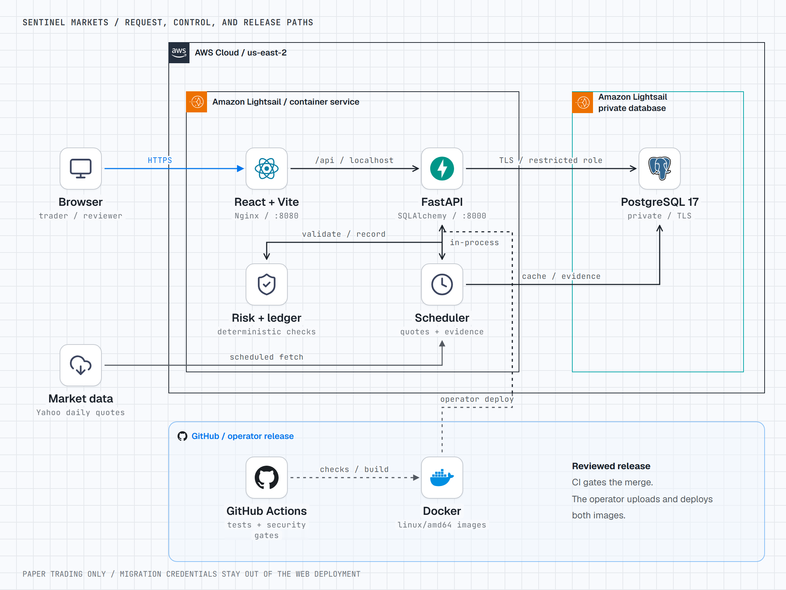

# Sentinel Markets

Sentinel Markets combines a paper-trading terminal, portfolio analytics, optional local AI research, and an experimental Kronos Forecast Lab. Orders, cash movements, and review decisions leave an audit trail, while research and forecasting remain advisory.

> Simulated cash and orders only, with no live broker connection. This is not investment advice or a compliance certification. Research notes and forecasts do not place orders or change hard risk limits.

**Source and the hosted release are different.** This repository contains the API and the frontend. The last recorded host release is deployment **7** (`fintechapp-preview.api.3`, `fintechapp-preview.web.4`, Alembic `f3a8c2d7e961`). That record is not a verification of the host today, and hosted parity with this branch was not rechecked.

**[Last recorded hosted preview](https://fintechapp-preview.gps5zt7wg4yqg.us-east-2.cs.amazonlightsail.com/)** · **[Preview API health](https://fintechapp-preview.gps5zt7wg4yqg.us-east-2.cs.amazonlightsail.com/api/health)** · [Control matrix](grc/control_matrix.csv) · [Security summary](Security.md)

## Workspaces

| Path | What it provides | Access |
| --- | --- | --- |
| `/`, `/dashboard` | Public market home or signed-in account overview | Account numbers require a session. |
| `/market` | Public discovery: search, Market pulse, heatmap, sector ETFs, news, and watchlists | Public market data. Private watchlists require a session. |
| `/market/:symbol` | End-of-day quote, daily chart, key stats, and company news | Public for an S&P 500 name or SPY, QQQ, DIA, and IWM. Company news requires a session. |
| `/trades` | Order preview, paper execution, fills, and cancellation | Signed in; execution role checks still apply. |
| `/portfolio` | Valuation, performance, allocation, and P&L attribution | Signed in. |
| `/risk` | Portfolio risk measures and read-only scenario previews | Signed in. |
| `/research` | Research jobs, reports (price, an interactive chart, SEC filings, and Finnhub news alongside the AI-generated note), and briefs | Signed in; model synthesis is opt-in. |
| `/forecasts` | Forecast jobs, results, models, and evaluation records | Signed in; Kronos inference is opt-in. |
| `/compliance` | Evidence, case reviews, access governance, and ops health | Authorized roles; trader accounts are denied. |
| `/login` | Sign-in | Public. |

The public home header has a **Log in** link to `/login` (signed-in visitors see **Open dashboard** instead). A **Get started** link also goes to `/login`. Admin and compliance-officer credentials are not published.

## Product path

1. Browse `/market`: cached end-of-day market context, no account required.
2. Sign in. Private watchlists support multiple lists, membership, and ordering. They can prefill a research or chart draft. Trade entry from a watchlist passes only the symbol.
3. Open a cached chart, then an explicit non-binding order preview, then confirm a supported paper order.
4. Matching uses actual opposing liquidity and price-time priority, including partial fills, cancel, and buying power. Idempotency keys are required on submit.
5. Fills, open reservations, portfolio, and risk views follow from the ledger. Missing marks stay null and dependent totals stay unavailable. The app does not draw a fabricated equity curve.
6. Research Desk and Forecast Lab jobs are owned by the user. Notes, briefs, and forecasts cannot place orders or change hard risk limits.

## Charts and market data

The signed-in daily chart uses Lightweight Charts 5.2.1: candle, line, and area series, volume, and SMA, EMA, Bollinger Bands, RSI, and MACD with configurable parameters. Its ranges are `1m`, `3m`, `6m`, `1y`, `2y`, and `all`. **All** means stored available history, not guaranteed full listing coverage. Chart preferences persist. Owned execution markers and open-order price levels are drawn for the signed-in account.

There is no intraday feed and no claim of a continuous provider entitlement. Quotes, risk, and paper execution stay on raw prices. Order execution still reads a live price through Alpha Vantage, described under Trading below.

### Massive quotes

The scheduled quote source defaults to `massive`. One grouped daily call loads the latest finished NYSE session. Overview, heatmap, and sector tiles label a Massive price as the prior session close, not a real-time quote. The one-session change uses the stored raw close from the immediately previous NYSE session. An older bar is ignored, and the change is then open-to-close. A symbol missing from that call, or a failed or malformed grouped payload, falls back to Alpha Vantage. With no Massive key, the same refresh uses Yahoo end-of-day quotes and says Massive is not configured. These cached prices are not used for order execution.

### Search, news, and the public menu

Default `GET /market/universe` browse is the S&P 500 constituent list plus SPY, QQQ, DIA, and IWM. An exact ticker search, or a symbol the signed-in user holds, can return a name outside that list with `in_featured_universe` false and the label `Outside S&P 500`. A partial search does not surface an unheld outsider. Ticker and company-name matching is case-insensitive. Held symbols sort first inside the page limit.

Public `GET /market/news` serves cached Finnhub headlines for SPY, QQQ, DIA, and IWM. The Market news card scrolls inside the same height cap as the stock heatmap. **Open menu** sits to the left of the brand and opens a left drawer. Escape, the backdrop, and Close menu dismiss it and return focus to the button. Reduced motion skips the slide.

### Market pulse

The public Market pulse card charts SPY, QQQ, DIA, and IWM from `GET /market/symbols/{symbol}/history` with provider `massive` and adjustment `split_adjusted`. Ranges are 1M, 3M, 6M, 1Y, and 2Y. Each line is the percent change from the first positive close in the range. Compare draws the four together. Separate draws one panel each. A table lists the same change and as-of date. The line breaks only when more than one weekday is missing. A single missing weekday stays connected. An empty or failed series stays blank. This card does not fall back to raw bars.

### Company research

`GET /market/research/{symbol}` prices the public panel from the latest Massive row in the quote cache. When that close is used, the panel labels the price `End of day` plus the quote date. Market cap is that price times shares outstanding and gets the same label. P/E is that price divided by trailing diluted EPS, shown to two decimals, and gets the same label. Non-positive trailing EPS stays blank. When that window cannot be built, P/E uses the Alpha Vantage overview figure and is not labeled end of day. The request reads the share-count cache and does not call Massive. A stale count stays until the scheduled refresh replaces it. If no Massive count is stored, the SEC cover count is used. Alpha Vantage supplies the quote only when the Massive close is absent. Overview text still comes from Alpha Vantage. This panel does not start a Research Desk job.

### Stock detail

`/market/:symbol` is public for the S&P 500 universe plus SPY, QQQ, DIA, and IWM. Heatmap tiles, mover rows, and research results link to it when the symbol can be served. `GET /market/symbols/{symbol}/quote` reads `MarketQuoteCache` and does not call a provider. A Massive quote is labeled as the raw last close. The page loads two years of Massive `split_adjusted` bars and plots 1M, 3M, 6M, YTD, 1Y, or 2Y as a line or candlestick, with volume. Gaps stay empty. If that adjusted series is empty, the page plots the raw bars and says so. Market cap and P/E come from the research response and render as unavailable when that response omits them. Company news uses the signed-in Finnhub route. Signed-out visitors see a sign-in prompt. Paper trade opens the existing order ticket.

### Daily bars and adjustment

`market_bars_daily` keeps `raw` and `split_adjusted` as separate series. Quotes, portfolio risk, and performance reads use the raw series. Bar volume is a decimal, so a fractional provider volume is preserved. A split-adjusted grouped response is stored only when the payload confirms `adjusted=true`. The Massive client paces at 4.8 requests per minute, a 12.5 second gap, and retries HTTP 429 with a bounded wait. `backfill_two_years` uses that client. An empty grouped day is a closed session only when the date is strictly before the latest finished NYSE session. The latest finished session, and any newer empty day, stays not yet available and is requested again. `NOT_FOUND` and `DELAYED` stay failures. One malformed day is recorded and the rest of the window continues.

The recorded local two-year run stored the **raw** series for the S&P 500 constituents and the four index ETFs. This file does not record a finished split-adjusted backfill. After migration `b7c91a0e4d62`, that series is loaded with `python -m app.scripts.backfill_massive_history --adjustment split_adjusted`. A later split uses `--refresh-adjusted`, which re-fetches the window and commits only when the refresh is complete. An incomplete refresh rolls back. Until those bars are stored, stock detail keeps the labeled raw fallback and Market pulse leaves an empty proxy blank.

## Trading, ledger, and access

Market and limit orders match against actual opposing liquidity. Partial fills, cancellation, and buying-power checks are implemented. Preview is explicit and non-binding; confirmation is a separate step.

Durable recovery for an unknown order outcome uses `sessionStorage` and is implemented for a same-tab reload. See [docs/P3B_ORDER_RETRY_DURABILITY_VERIFICATION.md](docs/P3B_ORDER_RETRY_DURABILITY_VERIFICATION.md). If that storage write fails, the recovery record is lost, so this is not a universal durability guarantee.

Order execution needs a configured `alpha_vantage_api_key` for its execution-time price read, separate from Massive's daily-close backfill. An unconfigured key fails a real order submission outright (`"Alpha Vantage API key is not configured."`), confirmed by actually placing an order locally.

Existing cash locking, hash-chained ledger postings, role approval versus privileged application, MFA step-up, and review controls remain in place. Surveillance and AML rules still need independent activation. See [Security.md](Security.md) for MFA, secrets rotation, and related boundaries.

## Portfolio analytics and risk

The supported contract windows for `GET /portfolio/performance` are `1y` and `2y`. The endpoint reports flow-adjusted time-weighted return, daily and cumulative P&L, drawdown, an SPY price benchmark, and Modified Dietz money-weighted return. Security and sector allocation and point-in-time P&L attribution are included. An open bug accepts `1m`, `3m`, `6m`, and `all` and still computes `2y`.

Risk metrics, when history is long enough, include volatility as a **sample per period** (not annualized), beta, historical VaR and expected shortfall at 95% and 99%, correlations, variance contributions, and fixed stresses. Scarce history returns unavailable or null. Numbers are not filled in.

`/portfolio/trade-impact` and `/risk/scenarios` are **read-only what-ifs**. They do not execute or approve anything. Trade impact ignores fees, slippage, margin, and open-order reservations. Order preview is non-binding: it applies the pre-trade checks, submission revalidates current state, and execution is authoritative.

**Open follow-ups, not fixed by this file:** the performance range bug above, divide-by-zero on a zero-value account in TWR, drawdown, Modified Dietz, and stress, and multiple separate reads on the risk-metric endpoints. Details are for [docs/REVIEW_2026-11-09.md](docs/REVIEW_2026-11-09.md).

## Research Desk

`/research` serves owner-scoped jobs and reports, daily watchlist briefs, and — alongside each AI-generated note — the symbol's current price, an interactive daily chart, its recent SEC EDGAR filings, and recent Finnhub company-news headlines. That desk is separate from the public company-research panel on `/market`.

A queued research job now starts processing immediately (via a FastAPI background task fired right after `POST /research/jobs` returns), instead of waiting only for the scheduler's periodic cycle. The periodic scheduler cycle still runs as a safety net for anything a crashed process or restart left behind.

Optional local synthesis uses Ollama. `research_synthesis_enabled` defaults to **false**. The configured model is `qwen3:14b` and the base URL defaults to `http://localhost:11434`, which must be reachable from the worker process — a containerized worker needs `host.docker.internal` (or equivalent) routing to reach an Ollama server running on the host, not `localhost`. The simple backend sends only source-status summaries, the company name, and a count. It does **not** send full SEC filing text, so this is not grounded or verified filing analysis. Real synthesis against a real local `qwen3:14b` model has been exercised directly (not through CI, which does not install or run Ollama): a cold model load took several minutes and exceeded the previous 120-second request timeout; `research_llm_timeout_seconds` (max 600s) should be raised accordingly for real local use.

Optional TradingAgents **v0.7.1** is listed in `requirements-research.txt`. Set `research_synthesis_backend` to `tradingagents` to use its Ollama backend. That upstream package can fetch Yahoo, SEC, and FRED itself. It is not an offline-only stack.

`GET /research/news/{symbol}` calls Finnhub's company-news endpoint when `finnhub_api_key` is configured. A missing or invalid key is an honest, expected 200 response with an empty article list and a non-null `error` field, not a failure — the same pattern `GET /market/research/{symbol}` already uses for a missing Alpha Vantage key.

Worker states are `queued`, `running`, `completed`, `failed`, and `cancelled`. Cancellation applies to queued jobs only. Scheduler limits exist. This README does not claim crash-safe job leases, a hard concurrent-cap guarantee, or a hard wall-clock bound. An open review issue is a count-then-insert race on the research cap (10) and the forecast cap (5).

Prompt tokens, completion tokens, and duration are recorded for simple Ollama research jobs and summarized in operator ops health. That is not complete model-cost accounting, and it does not bill TradingAgents or Kronos tokens. A real local Ollama call is recorded in [docs/P73_AI_USAGE_VERIFICATION.md](docs/P73_AI_USAGE_VERIFICATION.md) and the [backlog](docs/V2_BACKLOG.md).

## Forecast Lab

`/forecasts` lists owned jobs, supports cancel-while-queued, and shows results plus model metadata. The result view charts historical observed OHLC against predicted OHLC. `ForecastJob`, `ForecastResult`, and `ForecastEvaluation` are ORM models.

Kronos source is vendored. Config defaults are `NeoQuasar/Kronos-small` and Tokenizer-base (`NeoQuasar/Kronos-Tokenizer-base`). Those names are defaults, not a pinned weights revision. Default limits are lookback **400**, horizon **30**, and sample count **5**. `forecast_kronos_enabled` defaults to **false**.

`requirements-forecast.txt` is optional (PyTorch, pandas, and related packages). Hugging Face weights are not part of the default install. A real Kronos inference call against real downloaded weights (`NeoQuasar/Kronos-small` and its tokenizer) has been exercised directly, not through CI (~2.2s per call on CPU). That surfaced and fixed two real defects a mocked test suite had never caught: a broken vendored import and a pandas dtype bug in the forecast timestamp construction. A real, independent finding from that same run: raw model output has no hard OHLC-ordering guarantee (observed in 1 of 10 sample bars) — output is now widened to a self-consistent envelope before being stored. None of this is a walk-forward evaluation on real weights, a fixed 12-stock scope decision, or model-owner sign-off — all three remain open, and `forecast_kronos_enabled` remains **false** everywhere, including the hosted deployment.

The offline walk-forward harness calls the real adapter with a session-date `as_of` cutoff (commit `1000c4d`). Tests use a fake predictor. The `as_of` filter does not reconstruct historical data vintages and still reads the latest two-year cache. That is not a full point-in-time or revision-safe backtest, and it is not validated forecast accuracy. Weight downloads, machine capacity, and vendor or model-owner review stay separate. See [docs/FORECAST_LAB_OPEN_LIMITATIONS.md](docs/FORECAST_LAB_OPEN_LIMITATIONS.md). Its historical section 4 is superseded by [docs/P6F_KRONOS_POINT_IN_TIME_VERIFICATION.md](docs/P6F_KRONOS_POINT_IN_TIME_VERIFICATION.md).

The default API image installs `requirements.txt` only. AI extras and a model server must be configured on purpose. They are outside the default CI installation and need their own dependency and model validation before use.

## Compliance controls

Four versioned surveillance detectors (wash trading, spoofing/layering, pump-and-dump, unusual volume) and two AML rules (structuring, rapid movement) stay inactive until independent activation. Evidence, reviews, and role application remain separate from the operator path. MFA and secrets rotation are described in [Security.md](Security.md). With `YENTE_URL` empty on the last documented host, sanctions screening used a local fixture, not a live OFAC or OpenSanctions list. That statement is from the deployment record, not a check performed for this README.

`GET /compliance/ops-health` also reports Massive ingestion health (`symbols_covered`, `latest_session_date`, `flagged_last_30d_count`) and the Kronos weight-cache directory's on-disk size — a resource-consumption proxy, since no live scheduled Kronos worker process exists yet to sample CPU or memory from directly. The scheduler's own per-step isolation (one feature's step failing does not block the others, or release the scheduler's lock incorrectly) is covered by a dedicated test.

## Architecture reference

The images below illustrate the **last documented hosted layout**. Research and forecast services in this branch are part of the API process and the optional scheduler path. They are not proof of a deployed topology.

<picture>
  <source media="(prefers-color-scheme: dark)" srcset="docs/diagrams/sentinel-markets-stack-dark.png">
  <source media="(prefers-color-scheme: light)" srcset="docs/diagrams/sentinel-markets-stack.png">
  
</picture>

[Light PNG](docs/diagrams/sentinel-markets-stack.png) · [Dark PNG](docs/diagrams/sentinel-markets-stack-dark.png) · [Self-contained HTML](docs/diagrams/sentinel-markets-stack.html) · [Diagram sources and notices](docs/diagrams/NOTICE.md)

On that hosted layout, Nginx serves the React app and proxies `/api/` to FastAPI. PostgreSQL is private. The scheduler runs inside the API process. Schema changes used a separate temporary migration runner. Operations for that release are in [docs/aws_deployment.md](docs/aws_deployment.md). This file does not publish a new deployment.

| Layer | Technology |
| --- | --- |
| Web | React 19, TypeScript, Vite, Tailwind CSS, TanStack Query, Lightweight Charts |
| API | Python 3.12, FastAPI, SQLAlchemy, Pydantic |
| Data | PostgreSQL 17, Alembic |
| Optional research | Ollama; TradingAgents via `requirements-research.txt` |
| Optional forecast | PyTorch and Kronos via `requirements-forecast.txt` and separate weights |
| Local and host packaging | Docker, Nginx, Docker Compose |
| CI | GitHub Actions, seven jobs covering tests and security |

## Verification on 9 November 2026

Do not read this table as an all-green release. The manager record is [docs/REVIEW_2026-11-09.md](docs/REVIEW_2026-11-09.md). Historical unit logs are in [docs/V2_BACKLOG.md](docs/V2_BACKLOG.md).

| Run | Result |
| --- | --- |
| Local root, Python 3.14.6, `AUDIT_DATABASE_URL` unset | 515 passed, 28 skipped, 125.29s. Skips are 21 PostgreSQL proofs and 7 Selenium modules. This run is not PostgreSQL proof. The fresh pandas stub tests, 12 of 12, are included in this 515. They do not load real Kronos weights. |
| Review code `1ceee43`, GitHub Actions run [42667916677](https://github.com/slowgold05/Fintech-trading-risk-engine/actions/runs/42667916677) | All seven jobs passed. Backend: 533 passed, 10 skipped, 192.68s, including fresh PostgreSQL proofs. The 10 skips are 7 browser modules and 3 pandas-dependent Kronos tests (pandas is not installed in that CI job). |
| Frontend, fresh root run the same day | 417 tests in 30 files. Lint and the production build passed. The main bundle is 635.65 kB, with the existing size warning. |
| Linux browser job, same review-code CI | 10 passed, 1 hosted case excluded, 141.19s. This verifies the existing disposable-stack journeys and the watchlist readiness correction; it does not prove hosted parity or real-model inference. |

## Verification on 12 November 2026

Local root, Windows, `main` after merging through the Research Desk enrichment: backend 558 passed, 44 skipped, 8 errors (a pre-existing Windows-only `pytest-of-*` temp-directory permission quirk affecting every `tmp_path`-using test on this machine specifically, confirmed absent on GitHub Actions Linux CI). Frontend: 418 tests in 30 files passed; production build succeeded (638.56 kB main bundle, same pre-existing size warning).

This same session also exercised the running application directly end to end against a disposable local Postgres volume, a real Massive API key, a real Alpha Vantage key, and a real local Ollama model, not only through the automated test suite: user registration and login (including the credential-stuffing risk check actually tripping and clearing on a fresh database), the S&P 500 universe and live quotes, a real two-year Massive daily backfill for all 503 symbols, a real paper trade executing end to end against a real buying-power and ledger update, a real local-LLM research synthesis call producing a genuine bull/bear/synthesis/risks note, and the scheduler picking up queued research and forecast jobs on its own. This is a local, manual verification record, not a hosted one.

## Run locally

Prerequisites: Docker Desktop, Node.js 22, and npm. Core install does not include the research or forecast extras.

```powershell
Copy-Item .env.compose.example .env.compose
```

Replace `POSTGRES_PASSWORD`, `POSTGRES_APP_PASSWORD`, and `JWT_SECRET` with distinct random values, then start Postgres and the API:

```powershell
docker compose --env-file .env.compose up --build -d
```

In another terminal:

```powershell
Set-Location frontend
npm ci
npm run dev
```

Open **http://127.0.0.1:5173**. The API listens on **http://127.0.0.1:8000**. Interactive `/docs` is for local development only.

Compose uses its own database volume. It does not attach to the hosted database. Stop without deleting that volume:

```powershell
docker compose --env-file .env.compose down
```

Non-Compose setup and migration history: [docs/postgresql_migration.md](docs/postgresql_migration.md). Do not commit `.env` files, dumps, or account credentials.

### Tests

```powershell
python -m pip install -r requirements.txt -r requirements-dev.txt
python -m pytest -q

Set-Location frontend
npm ci
npm run lint
npm test
npm run build
```

Set `AUDIT_DATABASE_URL` only to a **fresh isolated container**. A fresh database on a shared server is not safe: some proofs `ALTER ROLE` at cluster scope. Never point them at the hosted database or a shared development instance. Optional AI extras are not required for the core suite.

## Where to read next

- [Sentinel Markets 2.0 roadmap](Sentinel_Markets_2_0_Roadmap.md) — scope of the expansion. Not every phase is complete.
- [V2 backlog](docs/V2_BACKLOG.md) — historical unit log.
- [Codex and Grok workflow](docs/GROK_CODEX_WORKFLOW.md) — how changes are scoped and reviewed.
- [Review, 9 November 2026](docs/REVIEW_2026-11-09.md) — findings and evidence. The manager creates this note and will fill final CI evidence after the pipeline. This README does not claim an all-green release.
- [Security.md](Security.md) — access, MFA, secrets, and control boundaries.
- [Control matrix](grc/control_matrix.csv)
- [Forecast Lab limitations](docs/FORECAST_LAB_OPEN_LIMITATIONS.md) and [point-in-time verification](docs/P6F_KRONOS_POINT_IN_TIME_VERIFICATION.md)
- [Research extras](requirements-research.txt) · [Forecast extras](requirements-forecast.txt)
- [Hosted release runbook](docs/aws_deployment.md) — last documented deployment only.
- [Diagram notices and third-party marks](docs/diagrams/NOTICE.md)

## Repository map

```text
app/                  FastAPI routes, models, services, and operator scripts
alembic/              Versioned database migrations
frontend/             React client and frontend tests
tests/                Backend unit, integration, and PostgreSQL proofs
grc/                  Control matrix inputs, workpapers, policies, model inventory
docs/diagrams/        Hosted-layout diagram (historical reference) and notices
docs/                 Roadmap, review evidence, security, and the deployment runbook
requirements*.txt     Core install, plus optional research and forecast extras
```

## Limits that remain

- Paper trading only. No broker, no real funds, no compliance certification.
- The last recorded host release is deployment 7. Hosted parity with this branch was not rechecked.
- Optional models stay off unless someone installs the extra requirements and points the worker at a model server. Enabling them is a separate decision. This README does not do it.
- Open review items include the performance-range bug, zero-account division, job-cap races, and multi-read risk metrics. None of those are closed here.
- A real LSE market-data adapter does not exist; Stage 3's fallback provider path is blocked on a real LSE account.
- Kronos's fixed 12-stock scope and a named model-owner reviewer are undecided. A finished 12-stock walk-forward evaluation on real weights is not recorded here. `forecast_kronos_enabled` stays false.
- Split-adjusted Massive daily bars are a separate series from the recorded raw backfill. This file does not record that adjusted-price backfill as finished.
- `finnhub_api_key` is empty by default; `/research/news/{symbol}` then returns an honest empty-list result rather than real headlines until a key is configured.
